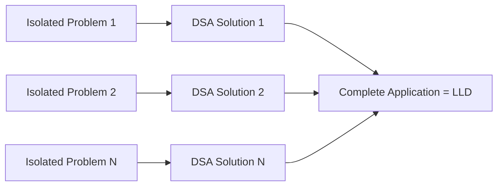
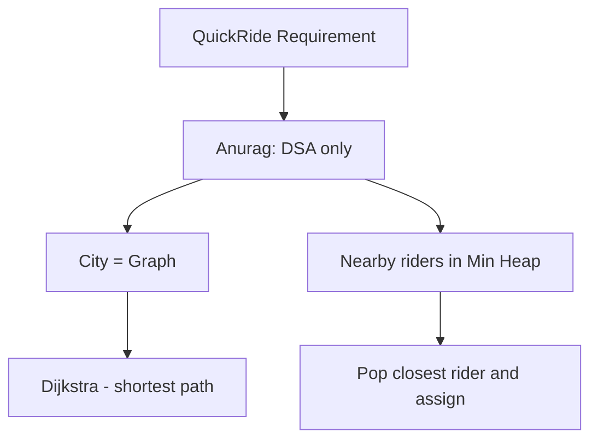
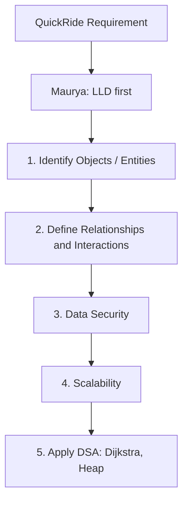
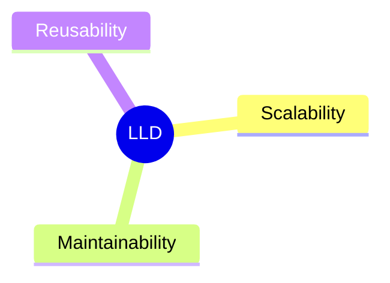
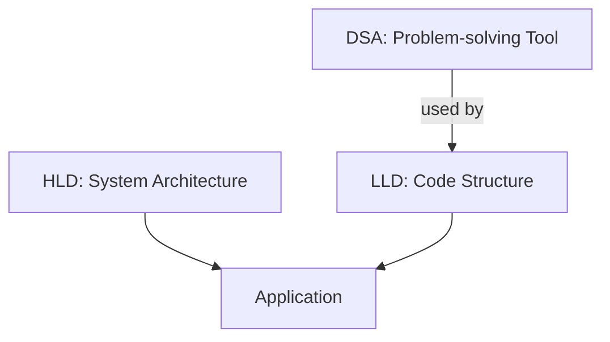

# LLD Lecture 1: Introduction to Low-Level Design (LLD)

> **Series:** LLD (C++ source code, Java also provided) | **Instructor:** Aditya (Code Army) | **Video length:** ~24:40
> **Prerequisite:** C++ (or Java) + basic DSA
> **One-line takeaway:** *DSA is the brain of an application, LLD is its skeleton.*

---

## Table of Contents

| Time | Chapter |
|------|---------|
| [00:00](#1-course-introduction-000--200) | 1. Course Introduction |
| [02:03](#2-what-is-lld-203--339) | 2. What is LLD? |
| [03:44](#3-lld-vs-dsa-the-quickride-story-344--1259) | 3. LLD vs DSA: The QuickRide Story |
| [12:59](#4-three-pillars-of-lld-1259--1722) | 4. Three Pillars of LLD |
| [17:22](#5-reusable-algorithms-1722--1843) | 5. Reusable Algorithms |
| [18:43](#6-lld-vs-hld-1843--2208) | 6. LLD vs HLD |
| [22:16](#7-final-thoughts--conclusion-2216--2440) | 7. Final Thoughts |

---

## 1. Course Introduction `[00:00 – 02:00]`

- **[00:00]** You have done DSA and coding. Now learn **how real-world applications are built**. DSA knowledge should not stay limited to solving LeetCode problems; use it practically.
- **[00:14]** Real-world apps like **Swiggy, Zomato, Ola, Uber**: how do they work? What does their backend structure look like? How do they handle **millions of users at once**?
- **[00:30]** LLD knowledge is a **must** for FAANG-type companies and top startups, for understanding HLD well, for open-source contribution, and for working in companies.
- **[00:48]** Series is **beginner friendly**, a one-stop solution for all LLD concepts, about **30-35 videos**.
- **[01:17]** After this series you should feel confident in any LLD interview.

### Prerequisites & Resources `[01:26 – 01:57]`

| Item | Detail |
|------|--------|
| Language | **C++** (all source code); Java code also provided |
| Notes | Complete notes provided |
| Code | Full **GitHub repository** shared with class code |

---

## 2. What is LLD? `[02:03 – 03:39]`

### DSA = isolated problems `[02:12 – 03:02]`

| Isolated Problem | DSA Solution |
|------------------|--------------|
| Search an element in an array | Linear Search (unsorted) / Binary Search (sorted) |
| Sort an array | Quick Sort, Insertion Sort, Merge Sort |

> Searching and sorting are **algorithms** that solve one **isolated problem** each.

### LLD = DSA wrapped in an application `[03:02 – 03:39]`

> **Definition:** When you build a **complete application** around one or multiple DSA concepts, that is **LLD**.

---

## 3. LLD vs DSA: The QuickRide Story `[03:44 – 12:59]`

### Characters `[03:44 – 04:45]`

- **QuickRide:** a ride-booking platform like Ola/Uber (books a ride, assigns a rider, takes the user from source to destination).
- **Anurag:** strong in **DSA**, **no LLD** knowledge.
- **Maurya:** strong in **DSA and LLD**.
- The manager asks both: *"Build the QuickRide application."*

### 3.1 Anurag's approach (DSA-only mindset) `[04:53 – 08:56]`

Mindset: *"Building an application = writing an algorithm."* He jumps straight into algorithms.

**Problem 1: Move user from source to destination `[05:25 – 06:58]`**

- Map the city as a **graph**: intersections = **nodes**, roads = **edges**.
- Find the shortest path with **Dijkstra's algorithm**.

**Problem 2: Assign a rider to a user `[06:58 – 08:43]`**

- For each user, keep a **Priority Queue (Min Heap)** of nearby riders (R1, R2, R3, R4...).
- Pop from the heap to get the **closest rider** and assign.

> **Recap:** Min Heap keeps the smallest element on top; Max Heap keeps the largest on top.

### 3.2 Manager's feedback on Anurag `[08:56 – 10:18]`

"This is just an **algorithm**. Where is the **application**?" Anurag never answered:

- Which **objects / entities** exist in the application?
- What is the **relationship** between them? How do they **interact**?
- How is **data security** maintained?
- How do we integrate **notifications** (e.g., "your ride is X km away")?
- How do we integrate a **payment gateway**?
- How will the app **handle millions of users** when it scales?

### 3.3 Maurya's approach (LLD-first) `[10:18 – 12:49]`

Mindset: *"First build the **structure/skeleton** (LLD). DSA comes much later."*

1. **Identify objects / entities:** `User`, `Rider`, `Location`, `Notification`, `Payment`. (In OOP almost everything can be an object; this is covered gradually.)
2. **Identify relationships:** how a `User` interacts with a `Rider`, how a `Rider` interacts with a `Location`.
3. **Data security:** sensitive data such as phone numbers. After a ride completes, rider and user must **not** see each other's numbers (as in Ola/Uber).
4. **Scalability:** how to build so the app **sustains** any number of users and does not break.
5. **Only then** apply DSA (what Anurag did): Dijkstra, heap-based rider assignment.

### Comparison: Anurag vs Maurya

| Aspect | Anurag (DSA only) | Maurya (LLD + DSA) |
|--------|-------------------|--------------------|
| Starting point | Algorithm | Application structure |
| Objects / entities | Not identified | Identified first |
| Relationships | Not defined | Defined |
| Data security | Ignored | Considered |
| Notifications / payments | Not considered | Planned for integration |
| Scalability | Not considered | Designed for |
| Uses DSA? | Yes, only that | Yes, as the last step |

---

## 4. Three Pillars of LLD `[12:59 – 17:22]`

LLD focuses mainly on three things:

### 4.1 Scalability `[13:29 – 14:13]`

- How well does the app **sustain millions of users**?
- How much effort is needed to **add a new feature**? How quickly can we scale?

### 4.2 Maintainability `[14:13 – 15:34]`

- Adding a new feature must **not break 4 old features**.
- Adding new code should take **minimal effort**.
- Code must be **easily debuggable**.
  - *Debug* = find bugs, but really means **checking code at every phase**.
  - No app has 0% bugs; aim for **minimum bugs**.

### 4.3 Reusability `[15:34 – 17:22]`

- Code should be **highly reusable**, following a **Plug and Play model**: lift code from one app, drop it into another, and it works.
- Example: **Notification** and **Payment** are application-independent. Reuse them in a Zomato/Swiggy clone.
- Key word: **Tightly Coupled**. Code should **NOT** be tightly coupled (fixated) to one application.

| Pillar | Core question |
|--------|---------------|
| Scalability | Can it handle growth in users and features easily? |
| Maintainability | Can we change, extend, and debug it without breaking things? |
| Reusability | Can we plug it into another app with minimal change? |

---

## 5. Reusable Algorithms `[17:22 – 18:43]`

**Example: Rider Mapping Algorithm** (closest rider assigned to the user)

This is a **generic algorithm**, not specific to QuickRide:

| App | Same algorithm, different entities |
|-----|-----------------------------------|
| Zomato / Swiggy | Delivery partner mapped to a user / restaurant / order |
| Amazon, Blinkit delivery | Delivery partner mapped to an order |
| QuickRide | Rider mapped to a user |

> The **entities change every time, but the algorithm stays the same**. Write code so that you can **remove an algorithm from one app and put it into another** without changing many things. That is the meaning of **reusability**.

---

## 6. LLD vs HLD `[18:43 – 22:08]`

Many people confuse these two. **HLD = High-Level Design**, **LLD = Low-Level Design**.

### What HLD focuses on `[19:01 – 21:00]`

| HLD concern | Meaning |
|-------------|---------|
| **Tech stack** | e.g., Java + Spring Boot |
| **Database choice** | SQL, NoSQL, or a hybrid model |
| **Server scaling** | After deploying on servers, how to expand under bulk traffic |
| **Cost optimization** | Servers (e.g., AWS) cost money. Scale up with traffic and scale **down** when users drop, to avoid wasting money |

- In an HLD / System Design interview you write **almost zero code**. You draw **architecture / system design diagrams** (users, servers, database).
- In LLD you draw **class diagrams** (covered later).
- HLD questions for QuickRide: *Which tech stack? Which database (SQL / NoSQL / both)? How to scale servers? How to optimize cost?*

### Comparison Table: HLD vs LLD vs DSA

| | **HLD** | **LLD** | **DSA** |
|---|---------|---------|---------|
| Full form | High-Level Design | Low-Level Design | Data Structures & Algorithms |
| Focus | **System architecture** | **Code structure** | **Problem solving** |
| Concerns | Tech stack, DB, server scaling, cost | Classes, objects, relationships, scalability, maintainability, reusability | Algorithms for isolated problems |
| Output | System design diagram | Class diagrams + code | Algorithm / solution |
| Code written | Almost none | Real code | Real code |
| Role | Architecture | Skeleton | Brain (a tool used by LLD) |

---

## 7. Final Thoughts & Conclusion `[22:16 – 24:40]`

- **Similarity:** HLD, LLD, and DSA are all used to **build an application**, and together they build it.
- **Difference:** HLD = system architecture, LLD = code structure, DSA = tool that LLD uses to solve problems.

> ### If DSA is the **brain** of an application, then LLD is its **skeleton**.

**Next video:** Pillars of OOPs (do not skip it even if you know OOPs; an in-depth OOPs playlist by Rohit is linked in the video).

---

## Interview Q&A

**Q1. What is LLD?**
Building a complete application around one or more DSA concepts. It focuses on the **code structure** (classes, objects, relationships), not just a single algorithm.

**Q2. How is LLD different from DSA?**
DSA solves **isolated problems** (search, sort, shortest path). LLD builds the **application structure** and uses DSA inside it as a tool.

**Q3. LLD vs HLD?**
HLD covers architecture (tech stack, DB choice, server scaling, cost optimization) and draws system diagrams. LLD covers code structure (classes, relationships) and draws class diagrams.

**Q4. What are the three pillars of LLD?**
Scalability, Maintainability, Reusability.

**Q5. What does "tightly coupled" mean and why is it bad?**
Code is fixated on one specific application, so it cannot be lifted into another. LLD aims for **loosely coupled, plug-and-play** code.

**Q6. Give an example of a reusable component.**
Notification and Payment modules, or the rider-mapping algorithm, which also works for Swiggy/Zomato/Amazon/Blinkit delivery partner assignment.

**Q7. What does maintainability mean in practice?**
New features don't break old ones, new code is easy to add, and code is easy to debug with minimal bugs.

**Q8. Which DSA concepts appeared in the QuickRide example?**
Graph + Dijkstra (shortest path), Priority Queue / Min Heap (closest rider).

**Q9. In the QuickRide example, which entities would you identify first?**
`User`, `Rider`, `Location`, `Notification`, `Payment`.

**Q10. Analogy to remember the DSA/LLD relationship?**
DSA is the **brain**, LLD is the **skeleton**.

---

## Revision Checklist

- [ ] DSA = isolated problems; LLD = complete application built around DSA
- [ ] Anurag (algorithm first) vs Maurya (structure first, DSA last)
- [ ] LLD questions: objects/entities, relationships, data security, notifications, payments, scale
- [ ] Three pillars: **Scalability, Maintainability, Reusability**
- [ ] Maintainability = easy to extend, easy to debug, new code doesn't break old code
- [ ] Reusability = plug-and-play, **not tightly coupled**
- [ ] Rider mapping algorithm is generic (Ola, Uber, Swiggy, Zomato, Amazon, Blinkit)
- [ ] HLD = tech stack, database, server scaling, cost optimization (system diagrams, near-zero code)
- [ ] LLD = code structure (class diagrams, real code)
- [ ] **DSA = brain, LLD = skeleton**
- [ ] Next: Pillars of OOPs

---

## Key Terms

| Term | Meaning |
|------|---------|
| LLD | Low-Level Design: code-level structure of an application |
| HLD | High-Level Design: system architecture |
| Priority Queue | Heap-based queue (Min Heap: smallest on top; Max Heap: largest on top) |
| Dijkstra | Shortest path algorithm on a graph |
| Tightly coupled | Code bound to one specific application |
| Plug and Play | Component can be dropped into any application and work |
| Server scaling | Expanding servers to handle bulk traffic |
| Debugging | Checking code at every phase to find and fix bugs |
