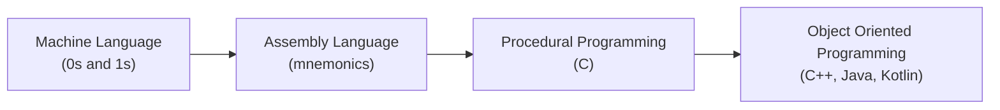
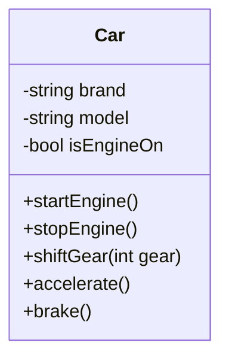
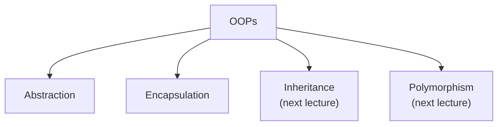
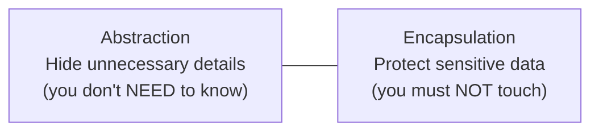

# LLD Lecture 2: OOPs Concepts, Abstraction & Encapsulation

> CampusX LLD series, Lecture 2 (Part 1 of OOPs). Inheritance and Polymorphism are covered in the next lecture.

## Table of Contents
1. [Why OOPs is the foundation of LLD](#1-why-oops-is-the-foundation-of-lld)
2. [History of Programming](#2-history-of-programming)
3. [Why OOPs? Problems with Procedural Programming](#3-why-oops-problems-with-procedural-programming)
4. [Objects, Classes, Characteristics & Behavior](#4-objects-classes-characteristics--behavior)
5. [Car and Owner: Procedural vs OOP](#5-car-and-owner-procedural-vs-oop)
6. [The Ideology of OOPs](#6-the-ideology-of-oops)
7. [Four Pillars of OOPs](#7-four-pillars-of-oops)
8. [Pillar 1: Abstraction](#8-pillar-1-abstraction)
9. [Pillar 2: Encapsulation](#9-pillar-2-encapsulation)
10. [Abstraction vs Encapsulation](#10-abstraction-vs-encapsulation)
11. [Interview Q&A](#11-interview-qa)
12. [Revision Checklist](#12-revision-checklist)

---

## 1. Why OOPs is the foundation of LLD

- OOPs gives a very strong base for understanding LLD (Low Level Design).
- Once OOPs is clear, LLD becomes much easier.
- Prerequisite: basic idea of **objects** and **classes** (C++ examples used in the lecture).

---

## 2. History of Programming



### 2.1 Machine Language
- Pure binary (`0101101...`) that talks **directly to the CPU**.
- **Problems**
  - Extremely **error prone**: flipping one bit changes the whole program.
  - Very **tedious** to write.
  - **Not scalable**: large applications are practically impossible.

### 2.2 Assembly Level Language
- Introduced **mnemonics** (English-like keywords), so more people could program.
- Example: `MOV A, 61H` moves the value `61H` into register `A`.
- **Problems**
  - Still error prone (missed instructions, mismatched registers).
  - **Tightly coupled to hardware**: hardware changes, so the code must change. Poor scalability.
  - No proper loops or methods like modern languages.
  - Not used for enterprise applications today.

### 2.3 Procedural Programming
- Came just before OOPs and introduced almost everything we use today **except OOP**:
  - Functions
  - Loops
  - Blocks (if/else, switch)
- Works like a **recipe book**: "do this, then do this, then do this." Code is a set of instructions.
- Example: **C**.
- Fine for small problems, but **not enough for enterprise-scale applications and complex problems**. This is why we moved to OOPs.

### Comparison Table

| Generation | Style | Strength | Weakness |
|---|---|---|---|
| Machine | Binary 0/1 | Runs directly on CPU | Error prone, tedious, not scalable |
| Assembly | Mnemonics (`MOV`) | Readable than binary | Hardware-coupled, not scalable |
| Procedural | Functions, loops, blocks | Structured code | Poor real-world modeling, weak reuse and security |
| OOP | Objects and classes | Models the real world, reusable, secure | (Next topics) |

---

## 3. Why OOPs? Problems with Procedural Programming

OOPs solves three gaps in procedural languages:

1. **Real-world modeling**: code should look like the real world.
2. **Data security**: protecting sensitive data (explained under Encapsulation).
3. **High scalability and reusability**: building large, reusable applications.

> Think of cloning **Uber, Ola, Zomato, Paytm**. These solve real-world problems, so the code should mirror the real world: **objects interacting with objects**.

---

## 4. Objects, Classes, Characteristics & Behavior

- In the real world **everything is an object** (mic, laptop, car, you).
- Objects **interact** with each other (you with the laptop, the speaker with the mic).

Every object has two things:

| Concept | Meaning | In code |
|---|---|---|
| **Characteristics** (state) | Identifying properties of the object | **Variables / attributes** |
| **Behavior** | What the object can do | **Methods / functions** |

### Real-life Car
- **Characteristics**: engine, brand, model, wheels
- **Behavior**: start, stop, shift gear, accelerate, brake

### Class = Blueprint
- A **class** is a blueprint for creating objects.
- From one class you can create **any number of objects**.

```cpp
class Car { /* characteristics + behaviors */ };

Car* myCar = new Car();   // object created from the blueprint
```



---

## 5. Car and Owner: Procedural vs OOP

### Without OOP (procedural)
To represent one car, you declare loose variables and functions:

```text
string brand;  string model;  bool isEngineOn;
void start();  void stop();   void shiftGear();
```

Now add an **Owner** who owns the car and drives it:

- Declare owner variables (`name`, ...).
- Write `void drive(brand, model)`. You **cannot pass a "car"** because no car object exists. You can only pass pieces of it (brand, model).
- Inside `drive`, call `start()`, `shiftGear()`, `accelerate()`.
- To add a **second car**, redeclare everything (`brand2`, `model2`, `isEngineOn2`). To add a second owner, repeat again.

**Result**
- Not scalable.
- Not reusable.
- Does not model the real world: a reader sees many functions calling each other, not "an owner owns a car".

### With OOP

```cpp
class Car {
    // brand, model, isEngineOn
    // start(), shiftGear(), accelerate(), brake(), stop()
};

class Owner {
    Car car;          // Owner owns a Car (object passed in)
    string name;
    void drive() {
        car.start();
        car.shiftGear();
        car.accelerate();
    }
};
```

- `Owner owns Car` in the real world becomes `Owner has a Car` in code.
- No parameters need to be passed around, because the `Car` object already exists inside `Owner`.
- Many cars and many owners are easy: just create more objects.

### Comparison Table

| Aspect | Procedural | OOP |
|---|---|---|
| Real-world modeling | Weak (loose variables and functions) | Natural (objects and interaction) |
| Reusability | Copy-paste variables (`brand2`, `model2`) | Reuse the class blueprint |
| Scalability | Poor | High |
| Representation of "Owner owns Car" | Complicated function plus params | `Owner` has a `Car` object |

---

## 6. The Ideology of OOPs

> **Programming should work the way the real world works: objects exist, and objects interact.**

When you read any OOP code from now on, see it as:

- A **bunch of objects** interacting.
- Interaction happens when:
  - one object **calls a method** of another, or
  - one object is **passed as a parameter** to another.

---

## 7. Four Pillars of OOPs

Representing an object is not enough. We also need to map the **actions and relationships** of real-world objects.



This lecture: **Abstraction** and **Encapsulation**.

---

## 8. Pillar 1: Abstraction

### Real-life intuition
- To **drive a car** you do not need to know how the engine or gearbox works internally. You only use the interface: key, clutch, gear lever, accelerator, brake.
- To **watch a video** on a laptop or phone you do not need to know its hardware. The **screen** is the interface.
- A **TV remote** is the interface to the TV. You do not need to know the wiring.

### Definition
> **Abstraction hides unnecessary details from a client and showcases only what is necessary.**

- **Client** = whoever uses the object or interacts with it.
- Knowing the hidden details would not hurt, but it is **not needed**. This is **data hiding**.


### Code idea (C++)
1. Create an **abstract class** `Car` with only **pure virtual methods** (the interface).
2. Create a concrete child class `SportsCar` that **implements** them.
3. The client uses a **parent pointer** to the child object.

```cpp
// Abstract class = interface (declaration only)
class Car {
public:
    virtual void startEngine() = 0;
    virtual void shiftGear(int gear) = 0;
    virtual void accelerate() = 0;
    virtual void brake() = 0;
    virtual void stopEngine() = 0;
    virtual ~Car() {}
};

// Concrete class (implementation hidden from client)
class SportsCar : public Car {
    string brand, model;
    bool isEngineOn;
    int currentSpeed, currentGear;
public:
    SportsCar(string b, string m) {
        brand = b; model = m;
        isEngineOn = false; currentSpeed = 0; currentGear = 0;
    }
    void startEngine() override {
        isEngineOn = true;
        cout << brand << " " << model << ": Engine starts with a roar!\n";
    }
    void shiftGear(int gear) override {
        if (!isEngineOn) { cout << "Engine is off! Cannot shift gear.\n"; return; }
        currentGear = gear;
        cout << "Shifted to gear " << gear << "\n";
    }
    void accelerate() override {
        if (!isEngineOn) { cout << "Engine is off! Cannot accelerate.\n"; return; }
        currentSpeed += 20;
        cout << "Accelerating to " << currentSpeed << " km/h\n";
    }
    void brake() override {
        currentSpeed -= 20;
        if (currentSpeed < 0) currentSpeed = 0;
        cout << "Braking! Speed is " << currentSpeed << " km/h\n";
    }
    void stopEngine() override {
        isEngineOn = false; currentGear = 0; currentSpeed = 0;
        cout << "Engine turned off.\n";
    }
};

int main() {
    Car* myCar = new SportsCar("Ford", "Mustang");  // parent pointer -> child object
    myCar->startEngine();
    myCar->shiftGear(1);
    myCar->accelerate();
    myCar->shiftGear(2);
    myCar->accelerate();
    myCar->brake();
    myCar->stopEngine();
    delete myCar;
}
```

> Code is a faithful reconstruction of the lecture's example, not a copy of the original file.

**Key points**
- `virtual` / pure virtual means the method is **declared, not defined** here. The **child class** defines it.
- A class with a pure virtual method is an **abstract class** and **cannot be instantiated directly** in C++.
- A **parent class pointer can point to a child class object**.
- The client only needs to know `startEngine, shiftGear, accelerate, brake, stopEngine`, not how they work internally.

### Programming languages are also abstraction
- Writing `if`, `for`, `while` in C++, Java, or Kotlin hides how it becomes machine code.
- The compiler converts it to machine code, and you do not need to know how.

### One-line memory hook
> **Abstraction hides unnecessary details from the client and shows only what is necessary.**

---

## 9. Pillar 2: Encapsulation

### Real-life intuition
- Like a **capsule**: medicine is inside a protective layer.
- A real object keeps **all its data (characteristics) and behaviors (methods) together** in one box.

### Encapsulation has TWO parts

#### Part 1: Bundle data and behavior together
- Put variables (characteristics) and methods (behaviors) inside **one class**.
- A class is that "box". It is also the blueprint for creating objects.

#### Part 2: Data security
- Some data must **not** be freely accessible or modifiable from outside.
- Example: a car's **odometer** or **current speed**:
  - You cannot directly set the odometer to 25,000 or the speed to 100.
  - They change only **through behaviors**: accelerate raises speed, driving raises the odometer.

### Access Modifiers (C++)

| Modifier | Who can access |
|---|---|
| `public` | Anyone, from outside the class |
| `private` | Only inside the class (hidden from outside) |
| `protected` | Inside the class and its **child classes** (covered in Inheritance) |

**Rule of thumb from the lecture**
- Keep **characteristics (data) `private`**.
- Keep **behaviors (methods) `public`**, because you need them to interact with the object.

### Problem demo: everything public

```cpp
SportsCar* mySportsCar = new SportsCar("Ford", "Mustang");
mySportsCar->currentSpeed = 500;   // allowed if public, but unrealistic!
```

Direct modification breaks real-world logic (a sports car at 500 km/h).

### Fix: make data private

```cpp
class SportsCar {
private:
    string brand, model;
    bool isEngineOn;
    int currentSpeed, currentGear;
public:
    // behaviors stay public
    void startEngine();  void shiftGear(int g);  void accelerate();
    void brake();        void stopEngine();
};
```

`mySportsCar->currentSpeed = 500;` now gives a compile error:
`'currentSpeed' is a private member of 'SportsCar'`.

### Getters and Setters
If the user should be able to **read** (or safely **change**) a private variable, expose a **public method**.

```cpp
// Getter: read only, no setter for currentSpeed so it can't be set directly
int getCurrentSpeed() { return this->currentSpeed; }

// Getter + Setter pair for a field that is safe to change
private: string tyre = "MRF";
public:
    string getTyre() { return this->tyre; }
    void setTyre(string tyre) {
        // validation goes here (e.g. valid string? known manufacturer?)
        this->tyre = tyre;
    }
```

- `currentSpeed`: **getter only** (read allowed, direct set not allowed).
- `tyre`: **getter and setter** (but the setter can validate first).

### Why use setters instead of making the variable public?
- Setters give **control**: you can add **validation** before assigning.
  - Is it a valid string?
  - Does this tyre company exist?
  - If not valid, `return` without setting.
- Public variables give **no such control**.
- So **prefer getters/setters over public variables**.

---

## 10. Abstraction vs Encapsulation

| | **Abstraction** | **Encapsulation** |
|---|---|---|
| Focus | **Data hiding** | **Data security** |
| Idea | Hide unnecessary details from the client | Bundle data and methods together and restrict access to sensitive data |
| If hidden data is seen | No harm (just not needed). You could open the engine and look, and it makes no difference | Harmful if exposed (e.g. editing the odometer or speed) |
| Real-life example | Driving a car without knowing the engine internals; TV remote | Odometer or current speed cannot be set directly |
| Mechanism in code | Abstract class or interface with pure virtual methods and a concrete implementation | Class plus `private` data plus `public` getters and setters |
| Example line | "You don't need to know." | "You are not allowed to touch." |



---

## 11. Interview Q&A

**Q1. Why did we move from procedural programming to OOPs?**
Procedural programming handles small problems but struggles with real-world modeling, data security, and building highly scalable, reusable enterprise applications. OOPs models real-world objects and their interactions, and supports security and reuse.

**Q2. What is an object? What is a class?**
An object has **characteristics** (variables) and **behaviors** (methods). A class is the **blueprint** from which any number of objects can be created.

**Q3. How do objects interact in OOP code?**
By one object calling another object's method, or by passing an object as a parameter to another.

**Q4. What is Abstraction?**
Hiding unnecessary implementation details from the client and exposing only what is necessary (data hiding). In C++ it is achieved with abstract classes and pure virtual methods.

**Q5. What is an abstract class in C++?**
A class with at least one pure virtual method. It cannot be instantiated directly, and a child class must implement the methods.

**Q6. What is Encapsulation?**
Bundling data and the methods that operate on it into one unit (a class), and restricting direct access to sensitive data using access modifiers (data security).

**Q7. Difference between Abstraction and Encapsulation?**
Abstraction is about **hiding** unnecessary details (nothing breaks if you see them). Encapsulation is about **securing** sensitive data (exposing it can cause harm).

**Q8. What are the access modifiers in C++?**
`public` (anyone), `private` (only within the class), `protected` (class and child classes).

**Q9. Why use getters and setters instead of public variables?**
They allow validation and control over how data is read or changed, preserving data security.

**Q10. Can a parent class pointer point to a child object?**
Yes, in C++ a parent class pointer can point to a child class object (e.g. `Car* c = new SportsCar(...)`). It is the basis for runtime polymorphism.

**Q11. Is a programming language itself an example of abstraction?**
Yes. Keywords like `if`, `for`, `while` hide the machine code the compiler generates.

---

## 12. Revision Checklist

- [ ] I can explain the progression: machine, assembly, procedural, OOP.
- [ ] I can name the 3 gaps of procedural programming: real-world modeling, data security, scalability/reusability.
- [ ] I know an object = characteristics + behavior, and a class = blueprint.
- [ ] I can explain the Owner-owns-Car example in both procedural and OOP style.
- [ ] I can state the OOP ideology: objects interact, via method calls or being passed as parameters.
- [ ] I can list the 4 pillars (Abstraction, Encapsulation, Inheritance, Polymorphism).
- [ ] I can define Abstraction in one line and give the car/TV remote example.
- [ ] I can write an abstract class with pure virtual methods and a child implementation.
- [ ] I can define Encapsulation with its two parts (bundling and data security).
- [ ] I know `public`, `private`, `protected`.
- [ ] I can explain getters and setters and why validation matters.
- [ ] I can clearly distinguish Abstraction (hiding) from Encapsulation (security).

**Next:** Inheritance and Polymorphism, then the wrap-up of OOPs.
