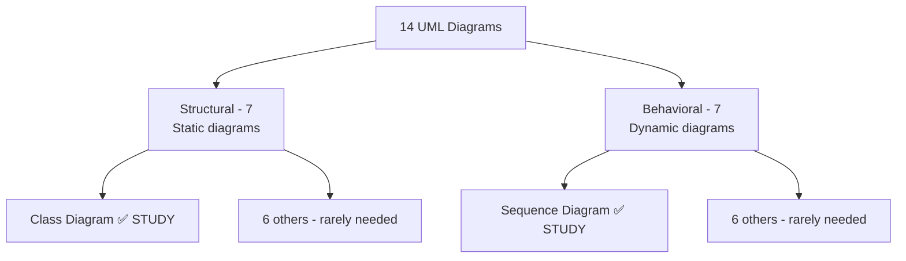
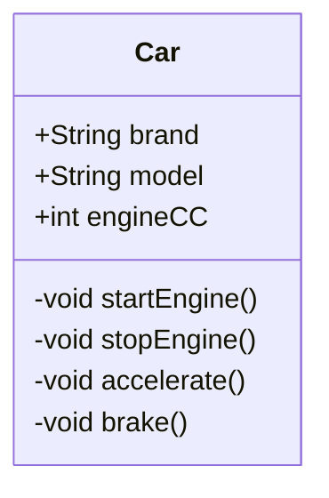
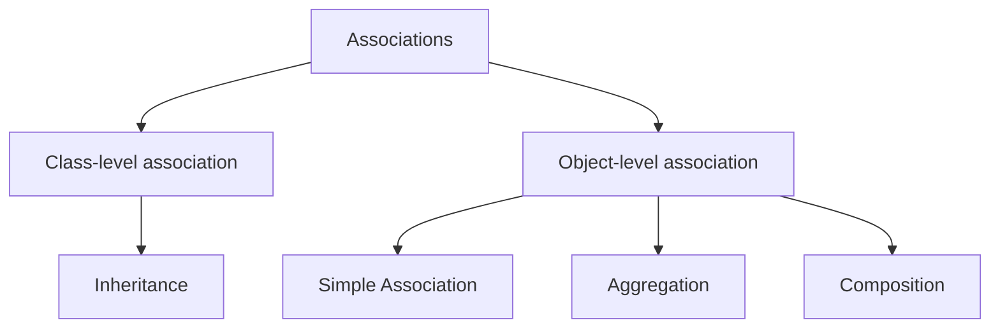
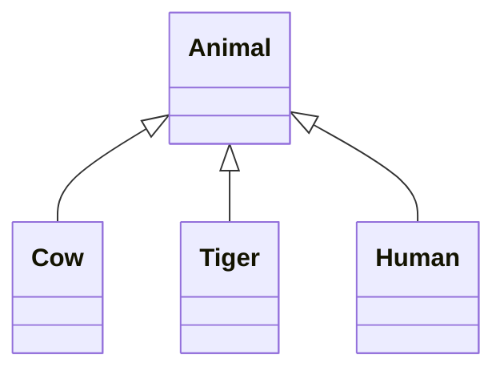
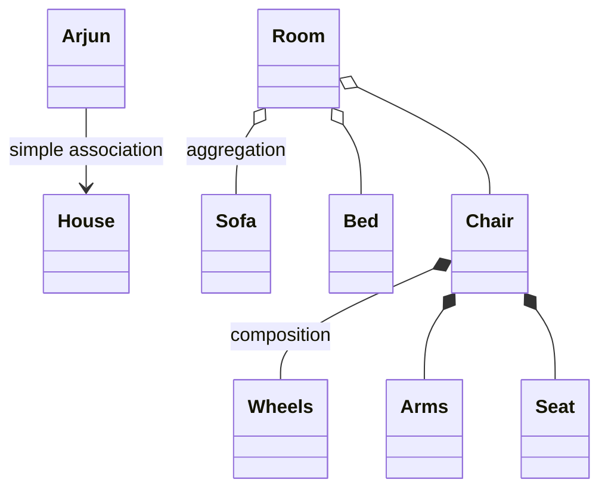
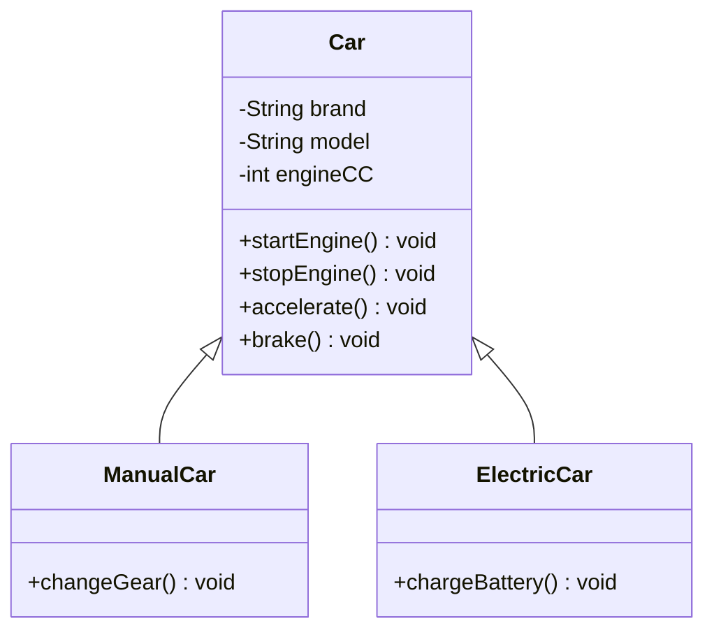
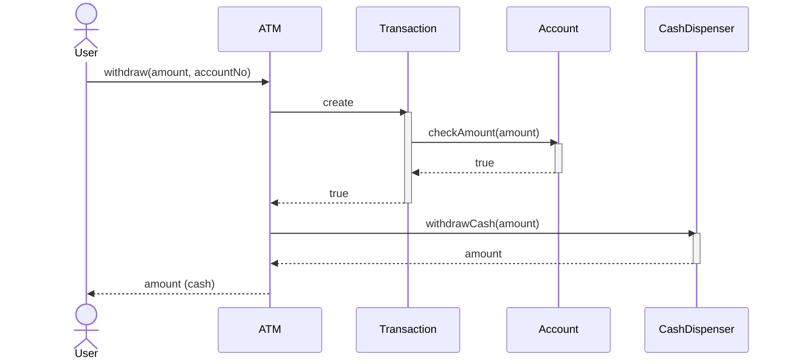

# UML Diagrams: Class & Sequence Diagrams (LLD Revision Notes)

> Source: CampusX LLD playlist, UML Diagrams lecture (~1h 12m)
> Focus: only the 2 UML diagrams that matter for LLD interviews.

---

## 1. What is UML?

- You have an app idea in your head and must communicate it. Writing paragraphs is boring and non-intuitive. A **diagram** is the intuitive way.
- **UML diagrams** = diagrammatic representation of:
  - which **components / objects / entities** exist,
  - how they are **connected**,
  - how they **interact** (messages / method calls).

## 2. Types of UML



| | Structural | Behavioral |
|---|---|---|
| Shows | Structure: components and how they connect | How components interact (messages, method calls) |
| Also called | Static diagrams | Dynamic diagrams |
| Count | 7 | 7 |
| Study | **Class Diagram** | **Sequence Diagram** |

- The other 12 are very use-case specific and almost never asked in LLD interviews.
- **Class diagram**: ~99% of LLD interviews ask you to draw one *before writing code*.
- **Sequence diagram**: rarely asked directly, but drawing/understanding it makes many problems crystal clear.

---

## 3. CLASS DIAGRAM

Shows (1) which classes exist and (2) how they are associated. Two things to learn: **class structure** and **associations**.

### 3.1 Representing a class: 3 compartments

```
┌──────────────────────┐
│     ClassName        │  <- 1. Name (add <<abstract>> if abstract)
├──────────────────────┤
│ access name : type   │  <- 2. Attributes (variables)
├──────────────────────┤
│ access name() : type │  <- 3. Methods (behaviors)
└──────────────────────┘
```

Note: in UML the **name comes first, then the data type** (reverse of C++).

**Example: Car class**



(The lecture's example marks attributes `+` public and methods `-` private to demonstrate the symbols. Real good design is the opposite, see encapsulation below.)

### 3.2 Access modifiers

| Modifier | UML symbol | Within class | Child class | Outside class |
|---|---|---|---|---|
| Public | `+` | ✅ | ✅ | ✅ |
| Protected | `#` | ✅ | ✅ | ❌ |
| Private | `-` | ✅ | ❌ | ❌ |

- Private is the most restrictive.
- Encapsulation / data security rule of thumb: **attributes private, behaviors (methods) public**.

### 3.3 Abstract vs Concrete class

- **Abstract class**: has at least one virtual (declared but not defined) method. Defined in the child class.
- Shown by writing `<<abstract>>` above the class name.
- **Concrete class**: nothing extra written.

### 3.4 Class representation: generic overview

1. Rectangle split into 3 parts.
2. Part 1: class name (+ `<<abstract>>` if applicable).
3. Part 2: `accessModifier name : dataType` for each variable.
4. Part 3: `accessModifier method() : returnType` for each method.

---

## 4. Associations (connections between classes)



- You only really need to study **Inheritance** and **Composition (has-a)**.
- In code, Simple Association, Aggregation, and Composition are all implemented the **same way** (see 4.3). They differ only in *how you think about the real-world relationship*.

### 4.1 Inheritance: **"IS-A"** relationship

- Child *is a* Parent. Always an IS-A relationship.
- Examples: Cow is an Animal, Tiger is an Animal, Human is an Animal, ManualCar is a Car, ElectricCar is a Car.
- UML symbol: **closed (hollow) arrow** from child to parent.



```cpp
class A { public: void method1(); };
class B : public A { public: void method2(); };

B* b = new B();
b->method1();  // inherited from A
b->method2();
```

### 4.2 Composition family: **"HAS-A"** relationship

> Inheritance = IS-A. Composition (all 3 types) = **HAS-A**.
> Trick: if you can say "X has a Y", it is some form of composition. If you can say "X is a Y", it is inheritance.
> Never "Room is a Sofa" or "Arjun is a House".

| Type | Strength | Idea | Example | UML symbol |
|---|---|---|---|---|
| **Simple Association** | Weakest | Two objects just linked | Arjun lives in a House | Open arrow `→` |
| **Aggregation** | Medium | Container object holds parts, parts **can exist independently** | Room has Sofa, Bed, Chair | **Empty diamond** ◇ at the container |
| **Composition** | Strongest | Parts **cannot exist without** the whole | Chair has Wheels, Arms, Seat | **Filled diamond** ◆ at the whole |



Key points:
- **Aggregation**: Room is the *aggregator / container*. A Chair or Bed can exist on its own outside a Room.
- **Composition**: Wheels, arms, seat have no independent existence without the Chair.
- Diamond is drawn at the **container/whole side** (lecturer: draw from part towards the whole, e.g. Sofa is a part of Room).
- Where the line between aggregation and composition is thin, it is **subjective**. No right or wrong, it depends on how you design the app.
  - Example (Zomato/Swiggy clone): Restaurant and Menu. If Menu can exist independently, use **aggregation**. If Menu cannot exist without a Restaurant, use **composition**.

### 4.3 Composition in code (same for all 3 types)

Hold a **reference to the other class** inside the class (not inheritance).

```cpp
class A {
public:
    void method1() { /* ... */ }
};

class B {
    A* a;                 // B HAS-A A
public:
    B() { a = new A(); }  // initialised in the constructor
    void method2() { /* ... */ }
};

int main() {
    B* b = new B();
    b->method2();          // direct
    b->getA()->method1();  // must go through A to reach method1
}
```

- B does **not** inherit method1, so you must fetch A first (`B -> A -> method1()`).
- Composition is used **even more than inheritance** in LLD design and code. Understand it well.

### 4.4 Quick symbol cheat sheet (class diagram)

| Relationship | Meaning | Symbol |
|---|---|---|
| Inheritance | IS-A | Closed (hollow) arrow |
| Simple association | HAS-A (weak) | Open arrow |
| Aggregation | HAS-A (parts independent) | Empty diamond ◇ |
| Composition | HAS-A (parts dependent) | Filled diamond ◆ |

### 4.5 Practice exercise (from the lecture)

Draw a class diagram for:
- A `Car` with 3 to 4 attributes and 3 to 4 behaviors.
- `ManualCar` (extra method: `changeGear()`) and `ElectricCar` (extra method: `chargeBattery()`).
- Decide whether to use **inheritance** or **composition**. If composition, decide which kind.

<details>
<summary>Answer hint</summary>


ManualCar *is a* Car and ElectricCar *is a* Car, so inheritance fits.
</details>

---

## 5. SEQUENCE DIAGRAM

- A **behavioral (dynamic)** diagram showing **how objects communicate with each other over time**: who sends what message to whom, and when.
- Unlike a class diagram, the class's internal structure does **not** matter here, so objects are just drawn as boxes with names.

### 5.1 Components

| Component | Meaning | Drawn as |
|---|---|---|
| **Object** | Participant (A, B, C...) | Box with name at top |
| **Lifeline** | When the object **exists** in the application | Vertical **dashed line** |
| **Activation bar** | When the object is **active** (can send/receive messages) | Thin rectangle on the lifeline |
| **Message** | Communication between objects | Arrows |

- Lifeline example: A and B exist from the start to the end. C is created midway, so its lifeline starts in the middle.
- A message sent to an object that is **inactive** (outside its activation bar) is not received.

### 5.2 Message types

| Message | Behavior | Symbol |
|---|---|---|
| **Synchronous** | Send, then **wait for the response** before the next message | Closed arrow `→` (solid line) + response as **dotted line** |
| **Asynchronous** | Keep sending without waiting for responses | **Open arrow** |
| **Create** | Creates a new object; new lifeline starts at the arrow | Arrow labelled `create` pointing at the new object's box |
| **Destroy** | Ends an object's lifeline | Arrow ending with **✕** on the lifeline |
| **Lost** | Message sent but never reaches a receiver (e.g. receiver inactive) | Arrow ending in a **filled circle** (dot) |
| **Found** | Message received whose **source is unknown** | Arrow starting from a **filled circle** |

### 5.3 Extra fragments (rarely used)

| Keyword | Meaning |
|---|---|
| `alt` | if / else |
| `opt` | only if (no else) |
| `loop` | for / while iteration |

- Mostly you draw the **happy flow** (everything succeeds). Alt/opt/loop appear only in larger diagrams.

### 5.4 How to draw a sequence diagram (3 steps)

1. **Define the use case / flow** (one flow = one diagram; an app can have thousands).
2. **Identify the objects** involved.
3. **Draw**: objects, lifelines, activation bars, then messages in order.

### 5.5 Worked example: ATM cash withdrawal (happy flow)

Objects: **User, ATM, Transaction, Account, CashDispenser**.
(PIN verification is skipped; it would be a separate use case.)



Flow walkthrough:
1. User sends `withdraw` (amount + account number) to ATM.
2. ATM sends a **create message**, so a **Transaction** object is born (one per transaction, for uniqueness).
3. Transaction sends a **sync** `checkAmount` to Account to verify sufficient funds. Account returns `true`.
4. Transaction returns `true` to ATM and is **destroyed** (its job is done).
5. ATM asks CashDispenser to `withdrawCash`; it returns the amount.
6. ATM hands the cash to the User; the flow ends.

Alt flow: if funds are insufficient, an `alt` block would show the `false` path.

---

## 6. Interview Q&A

**Q1. What is UML and why use it?**
A diagrammatic way to express an application's components, how they are connected, and how they interact, more intuitive than paragraphs.

**Q2. Structural vs Behavioral UML diagrams?**
Structural (static) show what components exist and how they connect, e.g. Class diagram. Behavioral (dynamic) show how components interact, e.g. Sequence diagram. 7 each, 14 total.

**Q3. Which UML diagrams matter for LLD interviews?**
Class diagram (almost always) and Sequence diagram (for specific flows).

**Q4. How do you represent a class in UML?**
A rectangle with 3 compartments: name, attributes, methods. Use `+ # -` for access modifiers and `<<abstract>>` for abstract classes.

**Q5. What are the UML symbols for access modifiers?**
`+` public, `#` protected, `-` private.

**Q6. IS-A vs HAS-A?**
IS-A = inheritance (Cow is an Animal). HAS-A = composition family (Room has a Chair).

**Q7. Difference between association, aggregation, and composition?**
Association is a simple link. Aggregation is a container with independently existing parts. Composition is the strongest form where parts cannot exist without the whole.

**Q8. How are all 3 HAS-A types implemented in code?**
Identically: keep a reference/object of one class inside another. The difference is conceptual.

**Q9. Aggregation vs Composition when unsure?**
Subjective; decide based on whether the part can exist independently in *your* design (e.g. Menu vs Restaurant).

**Q10. Lifeline vs Activation bar?**
Lifeline = when the object exists. Activation bar = when it is actively sending/receiving messages.

**Q11. Synchronous vs Asynchronous messages?**
Sync waits for a response (closed arrow + dotted return). Async doesn't wait (open arrow).

**Q12. What are lost and found messages?**
Lost = sent but never received. Found = received from an unknown source.

**Q13. Do you draw one sequence diagram for the whole app?**
No. One per use case / flow, and typically only the happy flow.

---

## 7. Revision Checklist

- [ ] UML = diagrammatic representation of components + connections + interactions
- [ ] 14 diagrams = 7 structural (static) + 7 behavioral (dynamic)
- [ ] Only study **Class Diagram** and **Sequence Diagram**
- [ ] Class box: Name / Attributes / Methods
- [ ] Format is `name : type` (name first)
- [ ] Access symbols: `+` public, `#` protected, `-` private
- [ ] Abstract class marked `<<abstract>>`
- [ ] Class-level association = Inheritance (IS-A, closed arrow)
- [ ] Object-level = Simple Association / Aggregation / Composition (HAS-A)
- [ ] Open arrow = simple association; empty diamond = aggregation; filled diamond = composition
- [ ] Aggregation: parts independent. Composition: parts dependent
- [ ] In code, HAS-A = reference to another class as a member
- [ ] Composition is used even more than inheritance in LLD
- [ ] Sequence diagram parts: Object, Lifeline, Activation bar, Messages
- [ ] Sync (closed arrow + dotted response) vs Async (open arrow)
- [ ] Create, Destroy, Lost, Found messages
- [ ] `alt` (if/else), `opt` (if), `loop` (iteration)
- [ ] Steps: define use case, identify objects, draw
- [ ] Practiced ATM sequence diagram and Car/ManualCar/ElectricCar class diagram

---

*Next topic in the series: SOLID design principles.*
