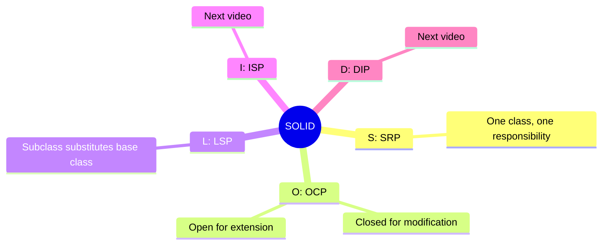
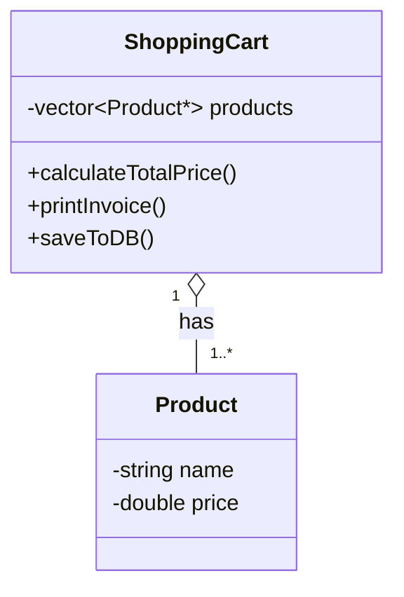
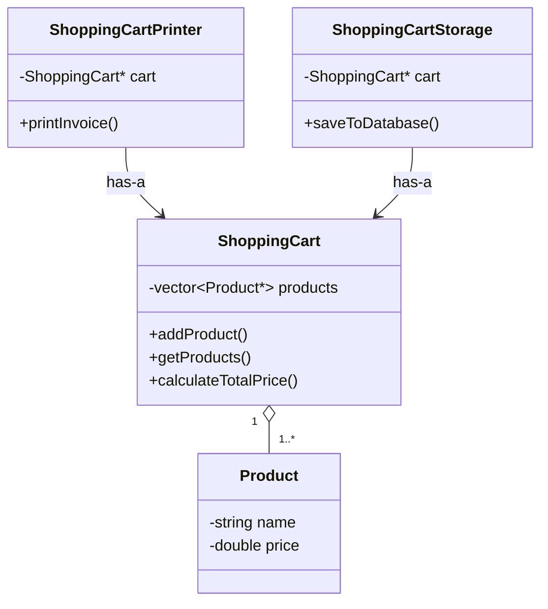
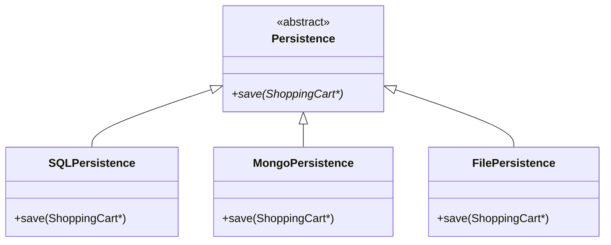
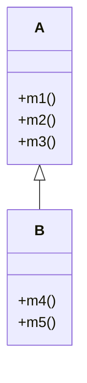
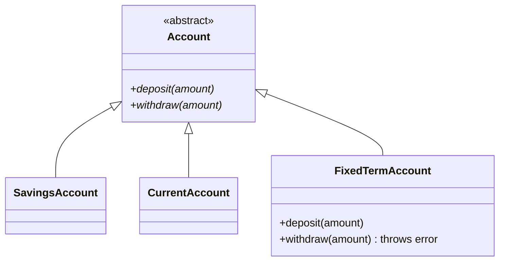
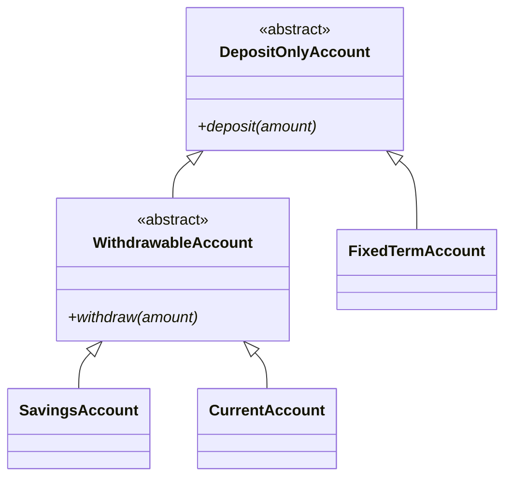
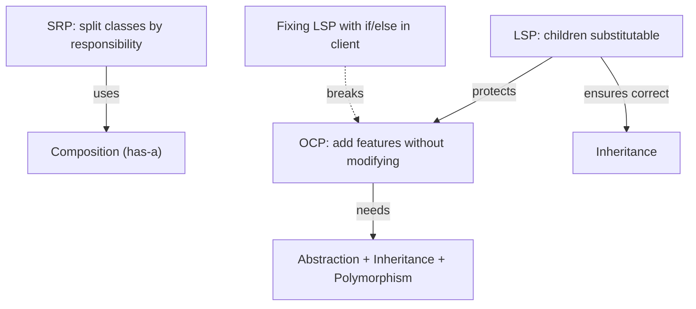

# SOLID Design Principles (Part 1: SRP, OCP, LSP)

> CampusX LLD Series | Lecture 3 | Language: C++
> Covers: **S**, **O**, **L**. The remaining two (**I**, **D**) come in the next video.

---

## Table of Contents
1. [Why Design Principles?](#1-why-design-principles)
2. [What is SOLID?](#2-what-is-solid)
3. [S: Single Responsibility Principle (SRP)](#3-s--single-responsibility-principle-srp)
4. [O: Open/Closed Principle (OCP)](#4-o--openclosed-principle-ocp)
5. [L: Liskov Substitution Principle (LSP)](#5-l--liskov-substitution-principle-lsp)
6. [Comparison Table](#6-comparison-table-of-the-three-principles)
7. [How the Principles Connect](#7-how-the-principles-connect)
8. [Interview Q&A](#8-interview-qa)
9. [Revision Checklist](#9-revision-checklist)
10. [Quick Cheat Sheet](#10-quick-cheat-sheet)

---

## 1. Why Design Principles?

OOP pillars (Abstraction, Encapsulation, Inheritance, Polymorphism) tell us **how to build classes**. But real-world projects have **thousands of classes**. Messy code means disastrous bugs, and bugs cost **technical and monetary** damage.

**Analogy:** A house where electrical wires, internet cables and water pipes all run through the same path in a tangle. If one fails, finding and replacing it is a nightmare, because everything is **tightly coupled**.

### Problems when principles are not followed

| Problem | Meaning |
|---|---|
| **Maintainability** | Adding a feature needs many code changes and introduces new bugs |
| **Readability** | New engineers waste time understanding tangled, tightly coupled code |
| **Bugs and debugging** | More bugs introduced, and more time spent resolving them |

**Goal:** clean code, easy to understand, and a manageable architecture.

> **Origin:** SOLID was introduced by **Robert C. Martin (Uncle Bob)**, who published a paper on it around **2000**.

---

## 2. What is SOLID?

| Letter | Principle | Short form |
|---|---|---|
| **S** | Single Responsibility Principle | SRP |
| **O** | Open/Closed Principle | OCP |
| **L** | Liskov Substitution Principle | LSP |
| **I** | Interface Segregation Principle | ISP |
| **D** | Dependency Inversion Principle | DIP |



---

## 3. S: Single Responsibility Principle (SRP)

### Definition
> **A class should have only one reason to change.**
> (or: *a class should do only one thing*)

**Analogy:** A TV remote controls only the TV. If the same remote also controlled the fridge and the AC, it would be complicated, hard to maintain, and hard to fix.

### Example: E-commerce Shopping Cart

#### Violation (all in one class)



`ShoppingCart` has **3 responsibilities**:
1. Calculating total price
2. Printing the invoice
3. Persisting to the DB

**Problem:** There are 3 separate reasons to change this class:
- DB logic changes → edit `ShoppingCart`
- Invoice format changes → edit `ShoppingCart`
- Price calculation changes → edit `ShoppingCart`

#### Fix (split into multiple classes via composition)



Each class now has **exactly one responsibility**, and a change in one area touches only one class.

### Code

#### ❌ Violating SRP
```cpp
class Product {
public:
    string name;
    double price;
    Product(string n, double p) : name(n), price(p) {}
};

class ShoppingCart {
private:
    vector<Product*> products;
public:
    void addProduct(Product* p) { products.push_back(p); }
    const vector<Product*>& getProducts() { return products; }

    double calculateTotal() {
        double total = 0;
        for (auto p : products) total += p->price;
        return total;
    }

    void printInvoice() { /* print invoice logic */ }   // ❌ not cart's job
    void saveToDatabase() { /* DB logic */ }            // ❌ not cart's job
};
```

#### ✅ Following SRP
```cpp
class ShoppingCart {                      // ONLY cart + price logic
private:
    vector<Product*> products;
public:
    void addProduct(Product* p) { products.push_back(p); }
    const vector<Product*>& getProducts() { return products; }
    double calculateTotal() {
        double total = 0;
        for (auto p : products) total += p->price;
        return total;
    }
};

class ShoppingCartPrinter {               // ONLY printing
    ShoppingCart* cart;
public:
    ShoppingCartPrinter(ShoppingCart* c) : cart(c) {}
    void printInvoice() { /* print invoice using cart */ }
};

class ShoppingCartStorage {               // ONLY persistence
    ShoppingCart* cart;
public:
    ShoppingCartStorage(ShoppingCart* c) : cart(c) {}
    void saveToDatabase() { /* DB logic using cart */ }
};
```

### ⚠️ Common Misconception
> **SRP does NOT mean "one method per class".**

A class **can have many methods**, but all of them must serve **one responsibility**.
Example: `calculateTotal()` may need 3-4 helper methods. That is fine, as long as together they do **one job**.

---

## 4. O: Open/Closed Principle (OCP)

### Definition
> **A class should be open for extension but closed for modification.**

| Term | Meaning |
|---|---|
| **Modification** | Changing existing, already-written code (editing old classes/methods) |
| **Extension** | Adding new features |

**Rule:** To add a new feature, **do not edit existing, tested classes**. Add new code instead.

> **Reality check (from the lecture):** This is a strict, idealistic rule and is not followed 100% everywhere in practice. Try to follow it as much as possible.

### How to achieve it
Use **Abstraction + Inheritance + Polymorphism (method overriding)**.

### Recap: Interface = Contract
An **interface** (an abstract class in C++) is a **contract between a client and a class**. It says *what* the class does, not *how*.

| Language | Construct |
|---|---|
| C++ | Abstract class (pure virtual functions) |
| Java | `interface` keyword |


### Example: Persistence in `ShoppingCart`

**New requirement:** Previously we saved only to a SQL DB. Now also save to **MongoDB** and a **File**.

#### ❌ Violation of OCP
Adding `saveToMongo()` and `saveToFile()` into the existing `ShoppingCartStorage` class means **editing an old, working class**.

```cpp
class ShoppingCartStorage {
    ShoppingCart* cart;
public:
    void saveToSQLDatabase() { ... }
    void saveToMongoDatabase() { ... }   // ❌ modified old class
    void saveToFile() { ... }            // ❌ modified old class
};
```

#### ✅ Following OCP
Introduce an **abstraction** (`Persistence`) and create **one new class per feature**.



```cpp
class Persistence {                       // abstraction (interface)
public:
    virtual void save(ShoppingCart* cart) = 0;   // pure virtual
    virtual ~Persistence() {}
};

class SQLPersistence : public Persistence {
public:
    void save(ShoppingCart* cart) override { cout << "Saving to SQL DB\n"; }
};

class MongoPersistence : public Persistence {
public:
    void save(ShoppingCart* cart) override { cout << "Saving to MongoDB\n"; }
};

class FilePersistence : public Persistence {
public:
    void save(ShoppingCart* cart) override { cout << "Saving to File\n"; }
};

// Client usage: runtime polymorphism
Persistence* db = new SQLPersistence();   // or Mongo / File
db->save(cart);
```

**Adding Cassandra later?** Create `CassandraPersistence : public Persistence`. **No old class is touched.** ✅

### What made this work?
- **Abstraction** → the `Persistence` interface
- **Inheritance** → the concrete classes extend it
- **Polymorphism** → the base-class pointer calls the right derived `save()` at runtime

---

## 5. L: Liskov Substitution Principle (LSP)

### Definition
> **Subclasses should be substitutable for their base classes.**
> Named after **Barbara Liskov**.

### Meaning
If a method expects an object of class `A`, then passing an object of its subclass `B` must work **without breaking anything**, and the code must behave correctly **as-is**.

```cpp
void clientMethod(A* a) {
    a->m1();
    a->m2();
    a->m3();
}

clientMethod(new A());   // works
clientMethod(new B());   // must ALSO work (B extends A)
```

### Rule of thumb
A subclass should **extend** the base class's behaviour, never **narrow/reduce** it.


`B` gets `m1, m2, m3` from `A` and adds its own `m4, m5` → ✅ **expands** the parent, LSP followed.

> It sounds trivial, but it is the **most commonly broken** principle in real projects, and usually **unintentionally**.

### Example: Bank Account

#### ❌ Violation of LSP



`FixedTermAccount` (FD) **allows deposits but not withdrawals**. So it has to override `withdraw()` by throwing an exception.

```cpp
class FixedTermAccount : public Account {
public:
    void deposit(double amt) override { balance += amt; }
    void withdraw(double amt) override {
        throw logic_error("Withdrawal not allowed in Fixed Term Account");  // ❌
    }
};

class BankClient {
    vector<Account*> accounts;
public:
    void processTransaction() {
        for (auto acc : accounts) {
            acc->deposit(1000);
            acc->withdraw(500);    // 💥 crashes for FixedTermAccount
        }
    }
};
```

**Why is this a violation?**
- The client believes *every* `Account` supports both `deposit` and `withdraw`.
- The child **narrows** the parent's contract.
- The client doesn't know about the exception, so it can't handle it.
- `FixedTermAccount` **can't substitute** `Account`.

#### ❌ Bad Fix: add `if/else` type checks in the client

```cpp
for (auto acc : accounts) {
    acc->deposit(1000);
    if (typeid(*acc) != typeid(FixedTermAccount))   // ❌ BAD
        acc->withdraw(500);
}
```

**Why this is bad:**
1. **Violates OCP**: every new account type forces you to edit the client class.
2. **Tight coupling**: the client now knows every concrete account type, defeating the purpose of abstraction. The client should only know the interface (`deposit`, `withdraw`).

> Fixing LSP by breaking OCP is no fix at all.

#### ✅ Correct Fix: redesign the hierarchy

**Root cause:** `FixedTermAccount` should never have been a child of `Account` (which promises `withdraw`).

**Solution:** split the abstraction into two levels.



- `DepositOnlyAccount` → only `deposit()` (a.k.a. NonWithdrawableAccount)
- `WithdrawableAccount extends DepositOnlyAccount` → inherits `deposit()`, adds `withdraw()`
- `SavingsAccount`, `CurrentAccount` → extend `WithdrawableAccount`
- `FixedTermAccount` → extends `DepositOnlyAccount` only

```cpp
class DepositOnlyAccount {
public:
    virtual void deposit(double amt) = 0;
    virtual ~DepositOnlyAccount() {}
};

class WithdrawableAccount : public DepositOnlyAccount {
public:
    virtual void withdraw(double amt) = 0;
};

class SavingsAccount : public WithdrawableAccount {
public:
    void deposit(double amt) override { /* ... */ }
    void withdraw(double amt) override { /* ... */ }
};

class CurrentAccount : public WithdrawableAccount { /* same */ };

class FixedTermAccount : public DepositOnlyAccount {
public:
    void deposit(double amt) override { /* ... */ }
    // no withdraw needed!
};

class BankClient {
    vector<WithdrawableAccount*> withdrawableAccounts;
    vector<DepositOnlyAccount*>  depositOnlyAccounts;
public:
    BankClient(vector<WithdrawableAccount*> w, vector<DepositOnlyAccount*> d)
        : withdrawableAccounts(w), depositOnlyAccounts(d) {}

    void processTransaction() {
        for (auto acc : withdrawableAccounts) {
            acc->deposit(1000);
            acc->withdraw(500);
        }
        for (auto acc : depositOnlyAccounts) {
            acc->deposit(1000);       // withdraw never called
        }
    }
};
```

**Why this works:**
- The client knows only the **interfaces**: "this list supports only deposit, that one supports both".
- No `if/else`, no type checks, so **no tight coupling**.
- Adding a new account type needs no client change, so **OCP is preserved**.
- Every subclass **expands** its parent and never narrows it, so **LSP holds**.

---

## 6. Comparison Table of the Three Principles

| Aspect | SRP | OCP | LSP |
|---|---|---|---|
| **Full name** | Single Responsibility | Open/Closed | Liskov Substitution |
| **Applies to** | A single class | Adding features to existing code | Inheritance hierarchies |
| **Core idea** | One class → one reason to change | Extend, don't modify | Child must be usable wherever parent is |
| **Main tool** | Composition, splitting classes | Abstraction + Inheritance + Polymorphism | Correct hierarchy design |
| **Violation smell** | A class with unrelated methods (DB + print + calc) | Editing old classes for each new feature | Child throws an exception or ignores a parent method |
| **Bad fix** | Keeping everything in one class | `if/else` chains per type | Type-checking in the client |
| **Example** | `ShoppingCart` split into Cart, Printer, Storage | `Persistence` → SQL/Mongo/File | `DepositOnly` → `Withdrawable` hierarchy |
| **Benefit** | Easy maintenance, fewer side effects | Safe feature addition | Reliable polymorphism |

---

## 7. How the Principles Connect



**Key insight:** A wrong LSP fix (type checks) breaks OCP. A correct LSP fix (a better hierarchy) keeps OCP intact.

---

## 8. Interview Q&A

**Q1. What is SOLID?**
An acronym for five object-oriented design principles by Robert C. Martin: SRP, OCP, LSP, ISP, DIP. They help write maintainable, readable, loosely coupled code.

**Q2. State the Single Responsibility Principle.**
A class should have only one reason to change, meaning it should handle one responsibility.

**Q3. Does SRP mean a class should have only one method?**
No. A class can have many methods, but all must contribute to the **same responsibility**. Helper methods supporting one job are fine.

**Q4. How do you fix an SRP violation?**
Break the class into multiple focused classes and connect them with **composition** (has-a). For example, split `ShoppingCart` into `ShoppingCart`, `ShoppingCartPrinter` and `ShoppingCartStorage`.

**Q5. State the Open/Closed Principle.**
Software entities should be open for extension but closed for modification.

**Q6. What do "extension" and "modification" mean here?**
Extension means adding new features or behaviour. Modification means changing existing, already-working code.

**Q7. How do you achieve OCP?**
Use abstraction (an interface or abstract class) and let new features be new subclasses (inheritance) resolved via polymorphism (method overriding).

**Q8. Give a practical OCP example.**
A `Persistence` abstract class with `save()`. `SQLPersistence`, `MongoPersistence` and `FilePersistence` override it. Adding Cassandra means adding one new class, with no change to existing ones.

**Q9. Is OCP always followed 100%?**
Rarely. It is an idealistic rule, so aim to follow it as much as practical.

**Q10. State the Liskov Substitution Principle.**
Subclasses must be substitutable for their base classes without breaking correctness. Wherever the base class is expected, the derived class should work as-is.

**Q11. Why is LSP the most commonly violated principle?**
It looks like basic inheritance, but developers unintentionally create children that **narrow** the parent's behaviour (throwing exceptions, leaving methods unsupported).

**Q12. Give an example of an LSP violation.**
`FixedTermAccount extends Account` but throws an exception in `withdraw()`. A client iterating over `Account*` and calling `withdraw()` crashes.

**Q13. Why is fixing LSP with `if (type == FixedTermAccount)` in the client bad?**
It violates OCP (the client changes for every new type) and creates tight coupling between the client and the concrete classes, which defeats abstraction.

**Q14. How do you correctly fix the bank account LSP violation?**
Redesign the hierarchy: `DepositOnlyAccount` (deposit) → `WithdrawableAccount` (adds withdraw). `FixedTermAccount` extends the former, while `Savings` and `Current` extend the latter.

**Q15. What is a good heuristic to detect an LSP violation?**
If a subclass throws `NotImplemented/UnsupportedOperation`, leaves an inherited method empty, or the client needs `instanceof`/type checks, LSP is likely broken.

**Q16. What is the relationship between LSP and OCP?**
OCP depends on polymorphism working reliably, which LSP guarantees. A bad LSP fix (type checks in the client) breaks OCP.

**Q17. What is an interface in OOP terms?**
A contract between a client and a class. It defines *what* the class can do without specifying *how*. It is implemented as an abstract class with pure virtual functions in C++, or an `interface` in Java.

**Q18. Why should a client talk to an interface, not a concrete class?**
It avoids tight coupling. The client stays unaware of implementation details and is unaffected when new implementations are added.

---

## 9. Revision Checklist

### Concepts
- [ ] I can explain why design principles exist (maintainability, readability, bugs)
- [ ] I know the SOLID acronym and who introduced it (Robert C. Martin)
- [ ] I can define SRP and explain "one reason to change"
- [ ] I know SRP ≠ one method per class
- [ ] I can define OCP and distinguish extension from modification
- [ ] I know OCP is achieved with abstraction + inheritance + polymorphism
- [ ] I can define LSP and explain "extend, never narrow"
- [ ] I understand why the `if/else` type check fix is wrong

### Examples to recall
- [ ] SRP: `ShoppingCart` → Cart + Printer + Storage
- [ ] OCP: `Persistence` → SQL / Mongo / File
- [ ] LSP: `Account` → `FixedTermAccount` problem → `DepositOnly` / `Withdrawable` fix

### Practice
- [ ] Draw all three UML diagrams from memory
- [ ] Write the C++ for the OCP and LSP examples without notes
- [ ] Revise exception handling in C++ (try/catch/throw), as it is used heavily in LLD
- [ ] Watch the next video: **ISP and DIP**

---

## 10. Quick Cheat Sheet

| Principle | One-liner | Red flag | Remedy |
|---|---|---|---|
| **SRP** | One class, one job | A class that prints, saves and calculates | Split classes, use composition |
| **OCP** | Extend, don't edit | Editing a tested class for every new feature | Abstract class + new subclass |
| **LSP** | Child can replace parent | Child throws "not supported" | Redesign the hierarchy |

> **Remember:** SRP is about *what a class does*, OCP is about *how you add features*, and LSP is about *how you design inheritance*.

---

*Next: Interface Segregation Principle (ISP) and Dependency Inversion Principle (DIP)*
