# SOLID Design Principles (Part 2: LSP Guidelines, ISP, DIP)

> CampusX LLD Series | Lecture 3 (continued) | Language: C++
> Covers: **LSP deep-dive (guidelines/rules)**, **I** (Interface Segregation), **D** (Dependency Inversion).
> Previous: [Part 1: SRP, OCP, LSP](./SOLID_Design_Principles_Part1.md)

---

## Table of Contents
1. [Recap](#1-recap)
2. [LSP Guidelines: Overview](#2-lsp-guidelines-overview)
3. [Signature Rule](#3-signature-rule)
4. [Property Rule](#4-property-rule)
5. [Method Rule](#5-method-rule)
6. [LSP Summary Table](#6-lsp-guidelines-summary-table)
7. [ISP: Interface Segregation Principle](#7-i--interface-segregation-principle-isp)
8. [DIP: Dependency Inversion Principle](#8-d--dependency-inversion-principle-dip)
9. [Closing Thoughts: Principles, not Laws](#9-closing-thoughts-principles-not-laws)
10. [Comparison Table: All 5 Principles](#10-comparison-table-all-five-solid-principles)
11. [Interview Q&A](#11-interview-qa)
12. [Revision Checklist](#12-revision-checklist)
13. [Quick Cheat Sheet](#13-quick-cheat-sheet)

---

## 1. Recap

| Done in Part 1 | Done in Part 2 |
|---|---|
| S: SRP | LSP guidelines (deep dive) |
| O: OCP | I: ISP |
| L: LSP (basics + bank account example) | D: DIP |

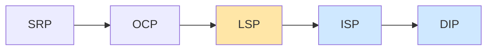

---

## 2. LSP Guidelines: Overview

> **Why a deep dive?** LSP looks simple but is the **most commonly broken** principle, and people often can't even *identify* that they broke it.

**Key idea:** A child class must not just *inherit* from the parent. It must **behave like** the parent. The client should notice **no difference** when a child replaces the parent.

### The three groups of rules

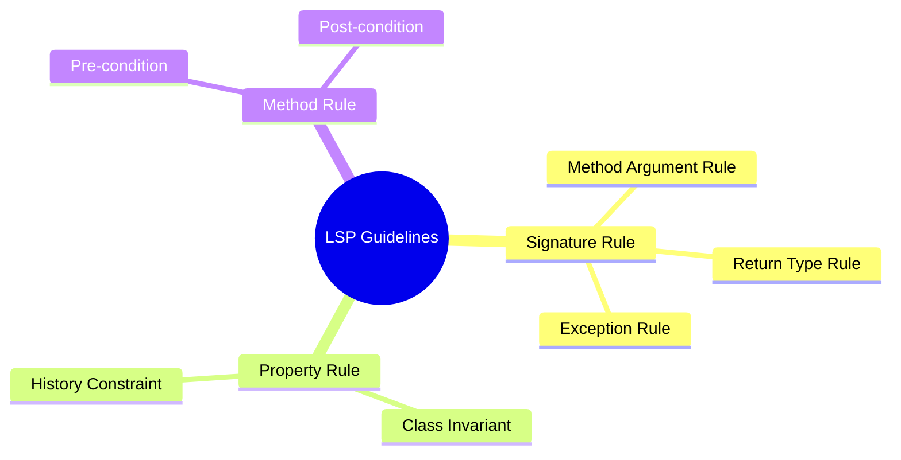

### Vocabulary: Broader vs Narrower

| Term | Meaning | Example |
|---|---|---|
| **Broader** type | Parent / any ancestor | `Animal` is broader than `Dog` |
| **Narrower** type | Child / any descendant | `Dog` is narrower than `Animal` |

> A **method signature** = method name + arguments + return type.

---

## 3. Signature Rule

### 3.1 Method Argument Rule

> When overriding, the child's argument type must be the **same as**, or **broader** than, the parent's argument type.

```cpp
class Parent {
public:
    virtual void solve(string s) { ... }
};
class Child : public Parent {
public:
    void solve(string s) override { ... }   // ✅ same type
    // void solve(int s) override { ... }   // ❌ compile error
};
```

- **C++ enforces this itself.** With `override`, a different argument type gives a compile error ("does not override a base class member").
- It is a **language-independent theoretical rule** (Java enforces it too).

**Why?** The client only knows the **parent's contract** (`solve(string)`). If the child demanded `int`, then `string` calls would break, since `int` is not a parent of `string`.

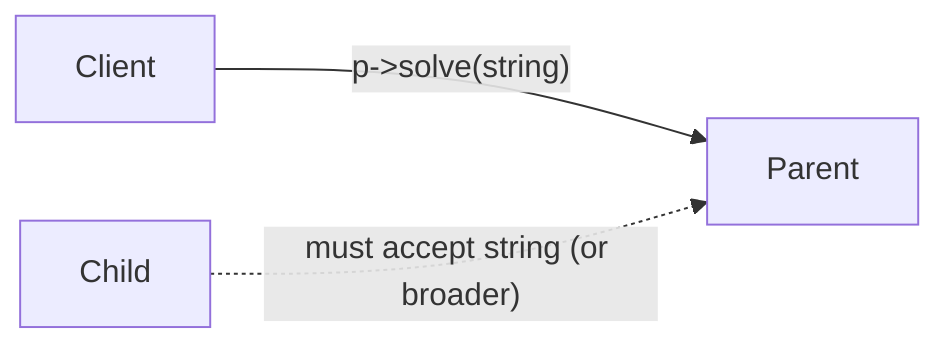

### 3.2 Return Type Rule (Covariance)

> The child's return type must be the **same as** or **narrower** than the parent's return type. **Never broader.**

Hierarchy used: `Animal` ← `Dog`

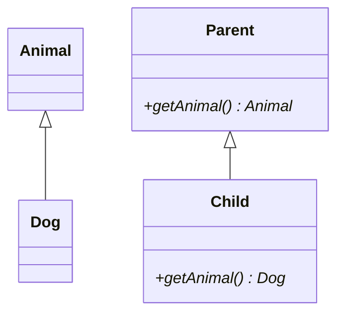

```cpp
class Animal { };
class Dog : public Animal { };

class Parent {
public:
    virtual Animal* getAnimal() { return new Animal(); }
};
class Child : public Parent {
public:
    Dog* getAnimal() override { return new Dog(); }   // ✅ narrower (covariant)
    // Organism* getAnimal() override ...             // ❌ broader (parent of Animal)
};

// Client
Animal* a = p->getAnimal();   // works for Animal* OR Dog*
```

**Why?** The client stores the result in an `Animal*`.
- `Dog*` → fits in `Animal*` ✅
- `Organism*` (a parent of `Animal`) → **cannot** fit in `Animal*` ❌

> **Covariance** = the child's return type is narrower than the parent's. In C++, 99% of the time we keep the same return type, but covariance is allowed.

### 3.3 Exception Rule

> The child may throw the **same exception** or a **narrower (subclass)** exception as the parent, **never a broader one.**

C++ exception hierarchy used:

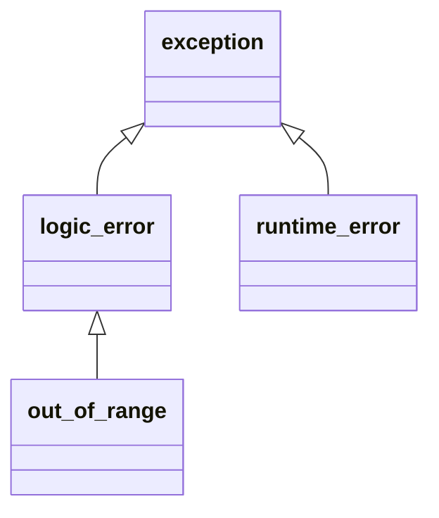

```cpp
class Parent {
public:
    virtual void getValue() noexcept(false) { throw logic_error("parent"); }
};
class Child : public Parent {
public:
    void getValue() noexcept(false) override {
        throw out_of_range("child");      // ✅ narrower (subclass of logic_error)
        // throw runtime_error("child");  // ❌ unrelated type
    }
};

// Client
try { p->getValue(); }
catch (logic_error& e) { /* handles logic_error and subclasses */ }
```

**Why?** The client's `catch` was written for the parent's contract (`logic_error`). A `runtime_error` from the child would **not be caught** → `terminate called after throwing an instance of 'std::runtime_error'` 💥.

### Signature Rule at a glance

| Sub-rule | Child must be... | Allowed | Not allowed |
|---|---|---|---|
| **Argument** | Same or **broader** | Same type / parent type | Different or narrower type |
| **Return type** | Same or **narrower** | `Dog*` for `Animal*` | `Organism*` for `Animal*` |
| **Exception** | Same or **narrower** | `out_of_range` for `logic_error` | `runtime_error` for `logic_error` |

---

## 4. Property Rule

### 4.1 Class Invariant

> **Invariant** = a rule/fact that must **always be true** for a class. The child must **preserve or strengthen** it, **never weaken or break** it.

An invariant is not a C++ feature. You write it as a **comment**, and it is **your responsibility** to enforce it.

**Example:** `BankAccount` with invariant: `balance >= 0`.

```cpp
// Invariant: balance can never be negative
class BankAccount {
protected:
    double balance;
public:
    BankAccount(double b) {
        if (b < 0) throw invalid_argument("Balance can't be negative");
        balance = b;
    }
    virtual void withdraw(double amt) {
        if (balance - amt < 0) throw runtime_error("Insufficient funds");
        balance -= amt;
        cout << "Withdrawn: " << amt << endl;
    }
};

// ❌ Breaks the invariant
class CheatAccount : public BankAccount {
public:
    CheatAccount(double b) : BankAccount(b) {}
    void withdraw(double amt) override {
        balance -= amt;     // no check! balance can go negative
    }
};
```

- A client written for `BankAccount` expects the balance **never** goes negative.
- `CheatAccount` allows ₹200 withdrawal from ₹100 → breaks the invariant → **not substitutable**.

### 4.2 History Constraint

> The child must not change the **"history" / state guarantees** the parent made. Behaviour the parent always allowed must **still be allowed** by the child.

**Example:** `BankAccount` guarantees "**withdrawal should always be allowed**" (history).

```cpp
// History constraint: withdrawal should always be allowed
class BankAccount {
public:
    virtual void withdraw(double amt) { /* allowed */ }
};

// ❌ Breaks history constraint
class FixedDepositAccount : public BankAccount {
public:
    void withdraw(double amt) override {
        throw runtime_error("Withdrawal not allowed in FD");
    }
};
```

This is exactly why `FixedDepositAccount` was *not substitutable* in the Part 1 bank example.

#### Bonus: Immutability (as explained in the lecture)
- `final` on a **class** → no one can inherit it.
- `final` on a **method** → no one can override it.
- If a parent marks something as fixed/immutable and a child makes it **mutable**, that is also a **history constraint violation**.

### Property Rule at a glance

| Sub-rule | What parent guarantees | Violation example |
|---|---|---|
| **Class invariant** | A condition is always true (`balance >= 0`) | `CheatAccount` allows a negative balance |
| **History constraint** | A behaviour/state is never altered (withdraw always allowed) | `FixedDepositAccount` blocks `withdraw` |

---

## 5. Method Rule

### 5.1 Pre-condition

> **Pre-condition** = a condition that must be true **before** a method runs.
> **Rule:** the child may keep it the **same** or **weaken** it, but must **never strengthen** it.

#### Simple example
```cpp
class Parent {
public:
    // PRE: 0 <= num <= 5
    virtual void m1(int num) {
        if (num < 0 || num > 5) throw logic_error("out of range");
    }
};
class Child : public Parent {
public:
    // PRE: 0 <= num <= 10 (weakened ✅)
    void m1(int num) override {
        if (num < 0 || num > 10) throw logic_error("out of range");
    }
    // PRE: 0 <= num <= 3 would be strengthened ❌
};
```

**Why?** Client knows "I may pass 0 to 5". If the child accepts 0 to 10, every legal call still works. If the child only accepted 0 to 3, a legal call with `4` would fail.

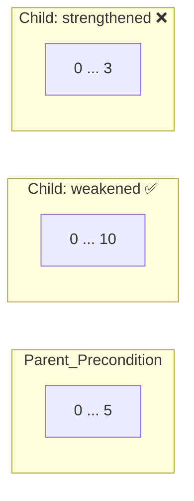

#### Practical example: Password length
```cpp
class User {
public:
    // PRE: password length >= 8
    virtual void setPassword(string p) {
        if (p.length() < 8) throw invalid_argument("Min 8 chars");
    }
};
class AdminUser : public User {
public:
    // PRE weakened: length >= 6 ✅
    void setPassword(string p) override {
        if (p.length() < 6) throw invalid_argument("Min 6 chars");
    }
};
```
> If the use case demands *exactly* 8, then the child must keep it as is. In general: **weaken ✅, strengthen ❌**.

### 5.2 Post-condition

> **Post-condition** = a condition that must be true **after** a method runs.
> **Rule:** the child may keep it the **same** or **strengthen** it, but must **never weaken it**. (Exactly the opposite of pre-condition.)

```cpp
class Car {
protected:
    int speed = 100;
public:
    // POST: speed must reduce after braking
    virtual void brake() { speed -= 20; }
};

class HybridCar : public Car {
    int charge = 50;
public:
    // POST: speed reduces AND charge increases (strengthened ✅)
    void brake() override {
        speed -= 20;
        charge += 10;
    }
};
```

- Client only expects "after brake, speed reduces". ✅ still true.
- If a child's `brake()` did **not** reduce speed → weakened ❌ → the car doesn't stop → dangerous 🚗💥.

### Pre vs Post Condition

| | Pre-condition | Post-condition |
|---|---|---|
| **When checked** | Before method runs | After method runs |
| **Child may** | Same or **weaken** | Same or **strengthen** |
| **Child must not** | **Strengthen** | **Weaken** |
| **Intuition** | Accept at least as much input | Promise at least as much output |
| **Example** | Password `>= 8` → `>= 6` ✅ | Speed reduces → speed reduces + charge increases ✅ |

---

## 6. LSP Guidelines Summary Table

| Category | Rule | Child must... | Typical violation |
|---|---|---|---|
| **Signature** | Method argument | Same or broader | Different arg type (C++ blocks it) |
| **Signature** | Return type (covariance) | Same or narrower | Returns a parent type |
| **Signature** | Exception | Same or narrower | Throws an unrelated or parent exception |
| **Property** | Class invariant | Preserve or strengthen | Breaks the parent's always-true rule |
| **Property** | History constraint | Not alter parent's guaranteed behaviour | Disables a method the parent always allowed |
| **Method** | Pre-condition | Same or **weaken** | Adds stricter input checks |
| **Method** | Post-condition | Same or **strengthen** | Delivers less than the parent promised |

### Practical red flags that a child is NOT substitutable
- Throws an exception in an overridden method it can't support
- Leaves an overridden method **empty**
- Returns a **hard-coded** value always
- Breaks any rule in the table above

---

## 7. I: Interface Segregation Principle (ISP)

### Definition
> **Many client-specific interfaces are better than one general-purpose interface.**
> A client should **not be forced to implement methods it doesn't need.**

> Note: the lecture occasionally said "Interface *Aggregation*" by mistake. The correct name is **Segregation**, meaning splitting apart.

### Problem: a "fat" interface

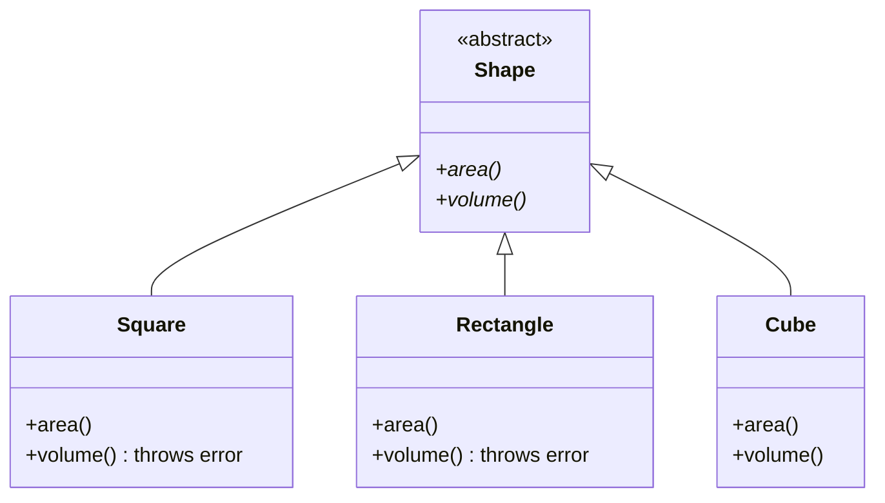

`Cube` (3D) needs `volume()`, so it was added to `Shape`. But `Square` and `Rectangle` (2D) **don't have volume**, yet are **forced** to implement it (usually throwing an exception).

#### ❌ Violating ISP
```cpp
class Shape {
public:
    virtual double area() = 0;
    virtual double volume() = 0;     // not every shape has a volume!
};

class Square : public Shape {
    double side;
public:
    double area() override { return side * side; }
    double volume() override { throw logic_error("Volume not applicable"); }  // ❌
};

class Rectangle : public Shape {
    double l, w;
public:
    double area() override { return l * w; }
    double volume() override { throw logic_error("Volume not applicable"); }  // ❌
};

class Cube : public Shape {
    double side;
public:
    double area() override { return 6 * side * side; }
    double volume() override { return side * side * side; }
};
```

### ✅ Solution: segregate the interface

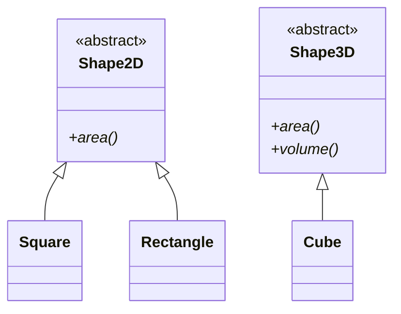

```cpp
class Shape2D {
public:
    virtual double area() = 0;
};

class Shape3D {
public:
    virtual double area() = 0;
    virtual double volume() = 0;
};

class Square : public Shape2D {
    double side;
public:
    double area() override { return side * side; }
};

class Rectangle : public Shape2D {
    double l, w;
public:
    double area() override { return l * w; }
};

class Cube : public Shape3D {
    double side;
public:
    double area() override { return 6 * side * side; }
    double volume() override { return side * side * side; }
};
```

Now every class implements **only what it needs**. 🎯

### ISP and LSP: the link
A fat interface forces children to throw exceptions or leave methods empty, which is an LSP violation. **Segregating the interface fixes both.** (This is the same trick used in the Part 1 `DepositOnly` / `Withdrawable` fix.)

---

## 8. D: Dependency Inversion Principle (DIP)

### Definition
> **High-level modules should not depend on low-level modules. Both should depend on abstractions.**

| Term | Meaning | Examples |
|---|---|---|
| **High-level module** | Deals with **business logic** | Application, `UserService` |
| **Low-level module** | Deals **directly with the system** | DB access, file system, external API calls |
| **Abstraction** | Interface or abstract class acting as a contract between the two | `Database`, `Persistence` |

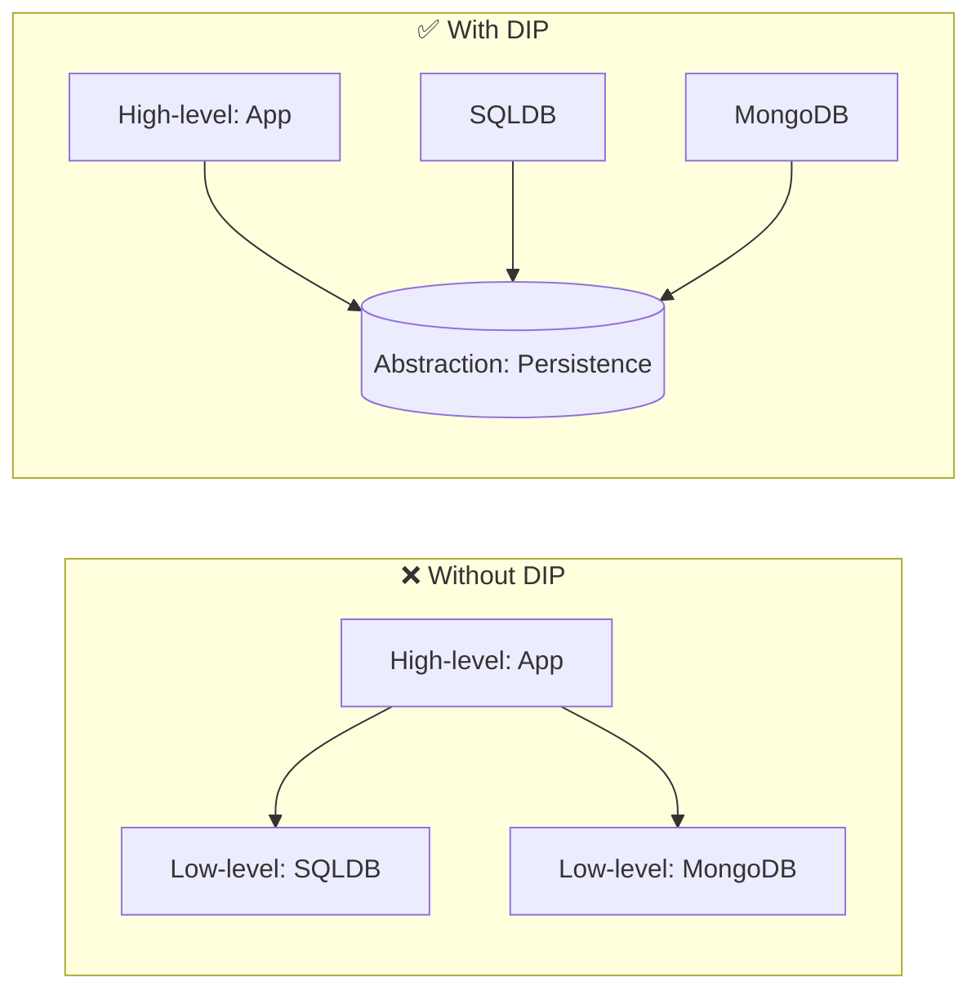

### Problem (without DIP)

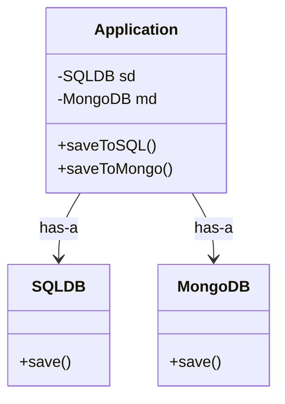

`Application` (high-level) **directly** holds the concrete `SQLDB` and `MongoDB`, so it is **tightly coupled**.
If MongoDB is replaced by **Cassandra**, we must **edit `Application`**: change the member, add a new method. This **breaks OCP**.

#### ❌ Code violating DIP
```cpp
class MySQLDatabase {
public:
    void saveToSQL(string data) { cout << "Executing SQL query: " << data << endl; }
};
class MongoDBDatabase {
public:
    void saveToMongo(string data) { cout << "Executing MongoDB function: " << data << endl; }
};

class UserService {                       // high-level module
    MySQLDatabase sqlDb;                  // ❌ direct dependency on low-level
    MongoDBDatabase mongoDb;              // ❌ direct dependency on low-level
public:
    void storeUserToSQL(string user)   { sqlDb.saveToSQL(user); }
    void storeUserToMongo(string user) { mongoDb.saveToMongo(user); }
};
```

### ✅ Solution: introduce an abstraction

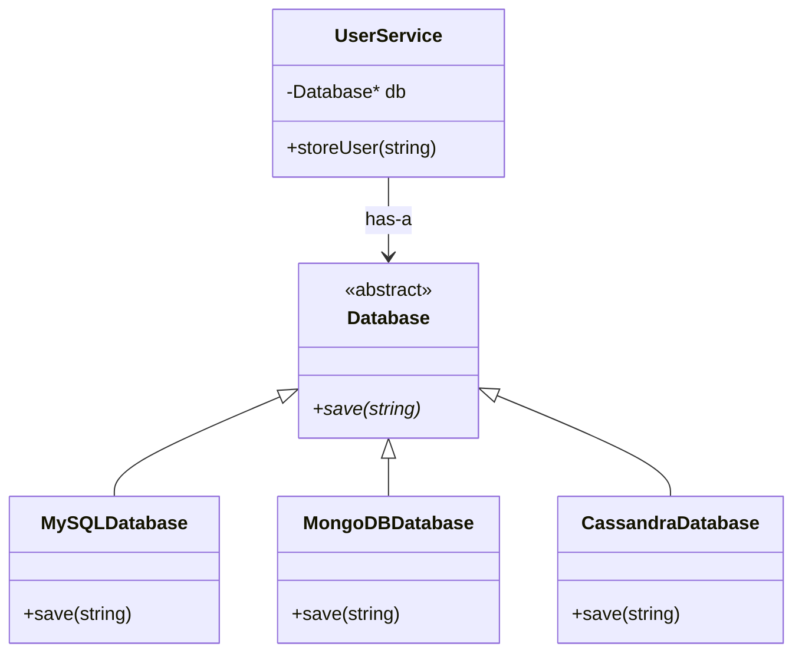

```cpp
class Database {                                   // abstraction
public:
    virtual void save(string data) = 0;
    virtual ~Database() {}
};

class MySQLDatabase : public Database {
public:
    void save(string data) override { cout << "Executing SQL query: " << data << endl; }
};

class MongoDBDatabase : public Database {
public:
    void save(string data) override { cout << "Executing MongoDB function: " << data << endl; }
};

class UserService {                                // high-level module
    Database* db;                                  // depends on abstraction only
public:
    UserService(Database* d) : db(d) {}            // 👈 Dependency Injection
    void storeUser(string user) { db->save(user); }
};

// Usage: polymorphism picks the implementation at runtime
UserService s1(new MySQLDatabase());
s1.storeUser("Vansh");
UserService s2(new MongoDBDatabase());
s2.storeUser("Vansh");
```

**Adding Cassandra?** Create `CassandraDatabase : public Database`. **`UserService` doesn't change.** ✅ OCP intact.

### What is Dependency Injection (DI)?
> Passing an object into a class from outside (e.g. via the constructor) instead of creating it inside. Here, `Database*` is **injected** into `UserService`.
> DI is a **technique** that helps achieve DIP. They are related but not identical.

### Golden line
> **"If OCP is the target, then DIP is the solution."**

### Real-life analogy: CEO, Manager, Developers

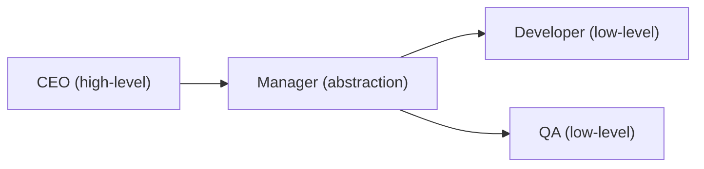

- The CEO never talks to developers directly. They go through the **Manager** (abstraction).
- Developers can join or leave, and the CEO is unaffected.
- Similarly, `UserService` talks to `Database`, not to a specific DB.

---

## 9. Closing Thoughts: Principles, not Laws

### "But OOP maps the real world, and real objects do many things!"
A real object (e.g. a human) has many behaviours: eat, sleep, work, sing. SRP still holds because, in **one application**, we model only the behaviours **relevant to that scenario**.

| Application | `User` behaviours modelled |
|---|---|
| Ola / Uber | book ride, cancel ride, go on ride |
| Swiggy / Zomato | order food, cancel order |

> Each application uses a **subset** of the real-world object's behaviours.

### Principles ≠ Laws
- SOLID principles are **ideals**, and few real apps follow them 100%.
- Sometimes you must **bend** them to handle **business logic**, since business logic is what makes money.
- This is a **trade-off** (like time vs space in DSA).
- Still: **the more you follow them, the cleaner, more extensible and more scalable your code.**

---

## 10. Comparison Table: All Five SOLID Principles

| | **SRP** | **OCP** | **LSP** | **ISP** | **DIP** |
|---|---|---|---|---|---|
| **Full name** | Single Responsibility | Open/Closed | Liskov Substitution | Interface Segregation | Dependency Inversion |
| **One-liner** | One class, one job | Extend, don't modify | Child can replace parent | Many small interfaces > one fat one | Depend on abstractions, not concretions |
| **Targets** | Class responsibilities | Adding features | Inheritance correctness | Interface design | Coupling between modules |
| **Violation smell** | Class doing DB + print + calc | Editing old classes for new features | Child throws / empty override | Child implements unused methods | `UserService` holds `MySQLDB` directly |
| **Main fix** | Split classes (composition) | Abstraction + inheritance + polymorphism | Redesign hierarchy / follow rules | Split interface | Introduce abstraction layer + DI |
| **Key example** | Cart / Printer / Storage | `Persistence` → SQL/Mongo/File | `Account` → `DepositOnly` / `Withdrawable` | `Shape` → `Shape2D` / `Shape3D` | `UserService` → `Database` → MySQL/Mongo |

### How they interlock

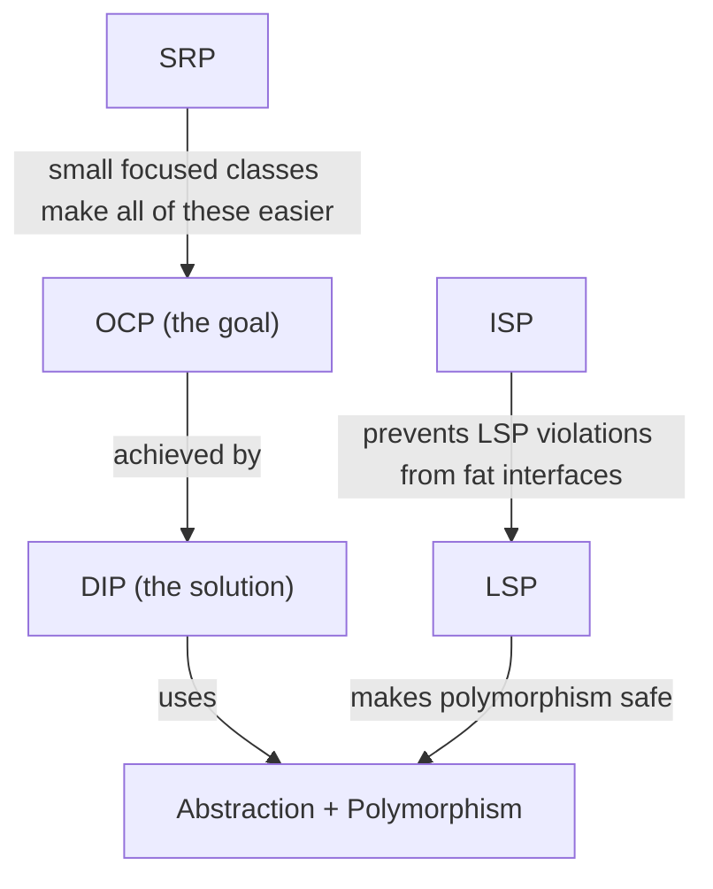

---

## 11. Interview Q&A

### LSP guidelines

**Q1. Is inheriting a parent class enough to satisfy LSP?**
No. The child must also **behave** like the parent. The client should notice no difference when a child replaces the parent.

**Q2. List the LSP guideline categories.**
Signature rule (argument, return type, exception), Property rule (class invariant, history constraint), Method rule (pre-condition, post-condition).

**Q3. What is the method argument rule?**
The child's overriding method must accept the same or a **broader** argument type than the parent. C++ enforces an exact match via `override`.

**Q4. What is the return type rule / covariance?**
The child's return type must be the same as or **narrower** than the parent's (e.g. parent returns `Animal*`, child returns `Dog*`). A broader type breaks the client.

**Q5. What is the exception rule?**
A child can throw the same or a **narrower** exception than the parent. Throwing a broader or unrelated exception causes uncaught exceptions in the client's `catch`.

**Q6. What is a class invariant?**
A rule that must always hold for a class (e.g. `balance >= 0`). A child must preserve or strengthen it, never break it.

**Q7. What is a history constraint?**
A guarantee about the behaviour/state the parent allows (e.g. withdrawal is always allowed). A child must not remove or alter it. `FixedDepositAccount` disabling `withdraw` violates it.

**Q8. State the pre-condition rule.**
The child can **keep or weaken** the pre-condition but must **not strengthen** it. A client following the parent's input rules must still work.

**Q9. State the post-condition rule.**
The child can **keep or strengthen** the post-condition but must **not weaken** it. A client relying on the parent's guaranteed outcome must still get it.

**Q10. Why are pre- and post-conditions opposite?**
Pre-conditions constrain *inputs* (the child should accept at least as much). Post-conditions constrain *outputs* (the child should promise at least as much).

**Q11. Give an example of a post-condition violation.**
`Car::brake()` guarantees speed reduces. A child whose `brake()` doesn't reduce speed weakens the post-condition → unsafe.

**Q12. Are invariants, pre- and post-conditions enforced by C++?**
No. They are contracts documented via comments, `assert`s or validation code, and enforcing them is the developer's responsibility.

### ISP

**Q13. State the Interface Segregation Principle.**
Many client-specific interfaces are better than one general-purpose interface. No client should be forced to implement methods it doesn't use.

**Q14. Give an example of an ISP violation.**
`Shape` with both `area()` and `volume()`. `Square` and `Rectangle` are forced to implement `volume()` even though 2D shapes don't have one.

**Q15. How do you fix it?**
Split into `Shape2D` (`area`) and `Shape3D` (`area`, `volume`). Each class implements only what it needs.

**Q16. How are ISP and LSP related?**
Fat interfaces force children to throw exceptions or leave methods empty, which violates LSP. Segregating interfaces avoids this.

### DIP

**Q17. State the Dependency Inversion Principle.**
High-level modules should not depend on low-level modules. Both should depend on abstractions.

**Q18. What are high-level and low-level modules?**
High-level = business logic (application, service). Low-level = direct system interaction (DB, file system, external API).

**Q19. Why is `UserService` holding `MySQLDatabase` directly a problem?**
It is tightly coupled. Switching to Cassandra means editing `UserService`, which breaks OCP.

**Q20. How does DIP fix it?**
Introduce a `Database` abstraction. `UserService` depends on `Database*`. Concrete DBs implement it, and polymorphism picks the real one at runtime.

**Q21. What is Dependency Injection and how does it relate to DIP?**
DI means passing a dependency into a class from outside (e.g. via the constructor). It is a technique used to *achieve* DIP, but not the same thing as DIP.

**Q22. How are OCP and DIP related?**
"If OCP is the target, DIP is the solution." Following DIP lets you add features without modifying existing code.

**Q23. Give a real-life analogy for DIP.**
A CEO talks to a Manager (abstraction), not directly to developers (low-level). Developers can change without the CEO noticing.

### General

**Q24. Are SOLID principles strict laws?**
No. They are ideals. Business logic sometimes requires trade-offs, but following them as much as practical gives cleaner, extensible, scalable code.

**Q25. If objects in real life do many things, doesn't SRP contradict OOP?**
No. In a given application we model only the behaviours relevant to that scenario (e.g. a `User` in Ola vs Zomato).

---

## 12. Revision Checklist

### LSP guidelines
- [ ] I can explain *broader* vs *narrower* types
- [ ] Argument rule: same or broader (C++ enforces exact match)
- [ ] Return type rule: same or narrower (**covariance**)
- [ ] Exception rule: same or narrower exception
- [ ] Class invariant: preserve or strengthen (`balance >= 0` example)
- [ ] History constraint: don't alter parent's guaranteed behaviour
- [ ] Pre-condition: **weaken ✅, strengthen ❌**
- [ ] Post-condition: **strengthen ✅, weaken ❌**
- [ ] I know the red flags (exception in override, empty override, hard-coded return)

### ISP
- [ ] Can define ISP in one line
- [ ] Can draw the `Shape` → `Shape2D` / `Shape3D` fix
- [ ] Can explain how ISP prevents LSP violations

### DIP
- [ ] Can define high-level vs low-level modules
- [ ] Can draw `UserService` → `Database` → MySQL/Mongo
- [ ] Can explain Dependency Injection (constructor injection)
- [ ] Can recall: *"OCP is the target, DIP is the solution"*
- [ ] Can narrate the CEO, Manager, Developer analogy

### Overall
- [ ] Can name all 5 SOLID principles with a one-liner and an example each
- [ ] Can explain why principles ≠ laws (trade-offs with business logic)
- [ ] Can code each example in C++ without notes
- [ ] Brush up on C++ exception handling (heavily used in LLD)

---

## 13. Quick Cheat Sheet

| Principle | Remember as | Red flag | Fix |
|---|---|---|---|
| **S** | One class, one job | Class does DB + print + calc | Split classes |
| **O** | Extend, don't edit | Editing old class for each new feature | Abstract class + new subclass |
| **L** | Child ≈ Parent | Child throws / ignores parent method | Fix hierarchy + follow rules |
| **I** | Small interfaces | Child implements methods it doesn't need | Split interface |
| **D** | Depend on abstractions | High-level class holds concrete low-level class | Introduce interface + inject it |

### LSP rules in one glance

| Rule | Direction |
|---|---|
| Argument type | Same or **broader** |
| Return type | Same or **narrower** |
| Exception | Same or **narrower** |
| Invariant | **Preserve / strengthen** |
| History | **Don't alter** |
| Pre-condition | **Weaken** only |
| Post-condition | **Strengthen** only |

> **Memory hook:** *Inputs get looser, outputs get tighter.* The child accepts at least as much and promises at least as much.

---

*Previous: [Part 1: SRP, OCP, LSP basics](./SOLID_Design_Principles_Part1.md)*
*Next in series: Design Patterns*
